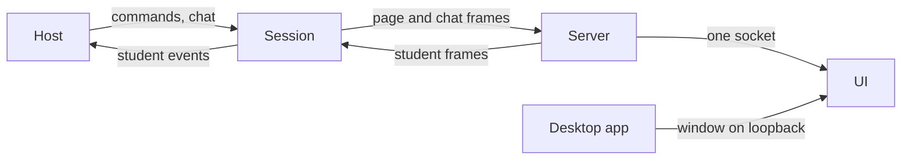

# Architecture

## Bird's eye view

Pedagogue shows a textbook page beside a tutor chat. A host (a model, or the sample script in this build) fills the page through page commands and writes into the chat. The student reads, answers quizzes and types messages. Everything the student does goes back to the host as one stream of events.

The session is the one place that holds state. A host changes it through a handle, the server sends each open page what changed, and the UI draws what it is sent.

## Code map

- `crates/pedagogue-session/` - the lesson model, the quiz rules, the chat transcript, the wire frames and the `Session` handle. It is the one crate a host depends on, and it stays free of Axum and Tauri.
- `crates/pedagogue-demo/` - a sample script player and a stand-in tutor. It uses the session crate exactly as a real host would.
- `crates/pedagogue-server/` - the Axum router: the UI files, the socket and a command route. Its build script runs `ui/build.mjs`, and the bundle is embedded into the binary.
- `crates/pedagogue-desktop/` - the Tauri app. It owns the session and the one async runtime, starts the server and the demo on it, and opens a window on the server's address.
- `ui/` - the TypeScript UI. `ui/src/main.ts` is the entry point. `ui/src/tokens.css` holds the layer order, the reset and the two palettes. `ui/src/page/` is the textbook side and `ui/src/chat/` is the tutor side, and each component keeps its CSS file beside it. `ui/build.mjs` bundles them into three files and copies the icon sprites out of the design files.
- `design/` - the two design reference files. They link the CSS files under `ui/src`, so the look has one home, and each keeps its icons in a sprite of its own.

## Invariants

- **Rust decides, the UI draws.** Page state and every quiz rule live in the session crate. The UI sends what the student did and draws the state it gets back.
- **The answer key stays in Rust.** The page the UI receives holds option states. Which option is right stays in the session until the rules release it.
- **One home for the look.** The CSS files under `ui/src` are read by the design files and bundled by the app.
- **Pages only grow.** A command adds to the newest page. Marking a quiz is the one change to an existing block.
- **HTML enters the page in one place.** `ui/src/markdown.ts` turns markdown into sanitized HTML. All other text goes in as plain text.

## Cross-cutting concerns

- **Wording.** Text the student reads lives in `ui/src/wording.ts`. Text a model reads (receipts, refusals and reports of student actions) lives in each Rust crate's `wording.rs`.
- **Errors.** Each kind of failure has its own opaque error type. An error is logged or returned, and the layer that handles it is the one that logs it.
- **Logging.** The libraries log with `tracing`. The binaries install the subscriber.
- **Tests.** Rust unit tests sit in the file under test, and tests of a crate's public API sit in one binary at `tests/it/main.rs`. UI tests load the built bundle into jsdom. Shared JSON fixtures pin the wire contract from both sides.
