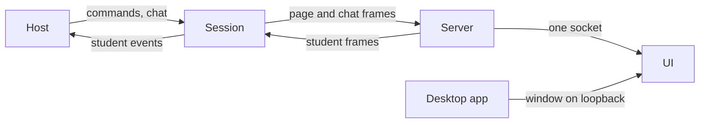

# Architecture

## Bird's eye view

TeachPad shows a textbook page beside a tutor chat. A host (a model, or the sample script in this build) fills the page through page commands and writes into the chat. The student reads, answers quizzes and types messages. Everything the student does goes back to the host as one stream of events.

The session is the one place that holds state. A host changes it through a handle, the server sends each open page what changed, and the UI draws what it is sent.

## Code map

- `crates/teachpad-session/` - the lesson model, the quiz rules, the chat transcript, the wire frames and the `Session` handle. It is the one crate a host depends on, and it stays free of Axum and Tauri.
  - `src/lesson.rs` holds the `Lesson`, its fold `Lesson::apply`, and the calls a student's actions go through. Its children are plain data and logic: `command.rs` (one argument struct per page command), `block.rs` (the blocks those arguments become), `quiz.rs` (quiz blocks and the part of them the UI receives), `quiz_rules.rs` (the quiz rules, as plain functions), `page.rs`, `id.rs` and `refusal.rs` (why a command or an action is refused).
  - `src/session.rs` holds the `Session` handle: one lock around the lesson and the chat, a version that rises with every change, and `changes_since`, which returns the pages and the chat changed since a reader's cursor. A student action first waits for room on the event channel and then takes the lock, so events reach the host in the order of the changes they report.
  - `src/chat.rs` holds the chat transcript, `src/frames.rs` the frames on the wire both ways, `src/changes.rs` the `Version` and what a reader gets back, and `src/error.rs` the two error types.
  - `src/event.rs` holds the events a host hears about the student.
  - `src/wording.rs` writes everything a model reads: receipts, refusals, and the line that reports each student event.
  - `fixtures/student-frames.json` holds one example of each frame the UI sends. The Rust tests and the UI tests both read it.
- `crates/teachpad-demo/` - a sample script player and a stand-in tutor. It uses the session crate exactly as a real host would, down to reading a new block's id out of its receipt.
  - `src/script.rs` reads a script, a JSON list of steps, and checks each step's shape and names up front.
  - `src/player.rs` holds `play`, which plays a script to its end, and `run`, which plays it and then answers the live student until its caller drops it. Neither spawns a task.
  - `src/stand_in.rs` is the stand-in: the typing dots and one fixed reply to a message, and a chat line with the text a tutor would be sent for everything else.
  - `src/wording.rs` holds the stand-in's lines, and `src/pace.rs` the two speeds a script plays at.
- `samples/` - the sample scripts. `contact-sheet.json` draws the two design files state for state, and `contact-sheet.frames.json` holds the frames the app sends for it. A Rust test keeps that file current, and the UI tests read it.
- `crates/teachpad-server/` - the Axum router: the UI files, the socket and a command route. Its build script runs `ui/build.mjs`, and the bundle is embedded into the binary.
  - `src/serve.rs` holds `bind`, which opens the loopback listener, and `serve`, one future that its caller runs. It stops on the caller's signal and ends when every socket has closed.
  - `src/app.rs` joins the routes of each feature and holds the state they share. `src/assets.rs` serves the three UI files by name, `src/socket.rs` runs one task per `/ws` connection with a cursor into the session, and `src/commands.rs` is `POST /commands`.
  - `src/cross_site.rs` guards the socket and the command route against other sites, `src/csp.rs` stamps the content policy on every response, and `src/error.rs` holds the refusals sent over HTTP.
  - `examples/serve.rs` runs the server and the demo together for a browser.
- `crates/teachpad-desktop/` - the Tauri app. It owns the session and the one async runtime, starts the server and the demo on it, and opens a window on the server's address.
  - `src/run.rs` holds `run`: it reads the script and opens the listener before the window exists, spawns the server and the demo on Tauri's async runtime, and after the window closes it signals the server and waits for it for a few seconds at most.
  - `src/navigation.rs` is the navigation policy: the window loads only the app's own address, and any other link opens in the system browser. The page has no access to Tauri's API, so links are handled in Rust.
  - `src/main.rs` only calls `run` and returns its exit code. `app-icon.png` is the source of the files in `icons/`, made with `cargo tauri icon`.
- `crates/teachpad-installer/` - the build tool behind the alias `cargo installer`. It builds the installers of one target with the Tauri bundler and copies each one into `target/installer/<target>/` under its release name. The app's crates stay independent of it.
  - `src/platform.rs` holds the four targets, the system each one is built on, the formats it gets, and the one definition of the release file names. `src/args.rs` reads the command line.
  - `src/tauri.rs` builds the command line of the Tauri CLI, the copy that `npm ci` installs under `ui/node_modules`, and tells it the target folder, so the build writes where the tool reads. `src/collect.rs` clears the folders a build writes to, and afterwards finds the one file each bundler left and copies it.
  - `src/run.rs` holds `run`: the steps in order and the exit code. Each child process starts through a closure, so the tests record every command and write the files a real build would.
- `ui/` - the TypeScript UI. `ui/src/main.ts` is the entry point. `ui/src/tokens.css` holds the layer order, the reset and the two palettes. `ui/src/page/` is the textbook side and `ui/src/chat/` is the tutor side, and each component keeps its CSS file beside it. `ui/build.mjs` bundles them into three files and copies the icon sprites out of the design files.
  - `src/main.ts` builds the two panes and then opens the socket. It is the one file that imports both sides.
  - `src/protocol.ts` holds a Zod schema for each frame and block kind, and the types come from the schemas. `src/socket.ts` is the one socket: it drops a frame that fails its schema with a warning, and it reconnects on its own.
  - `src/wording.ts` holds every fixed line the student reads, and `src/dom.ts` the helpers that build nodes.
  - `src/markdown.ts` turns markdown into nodes: marked, then DOMPurify, then the classes of the design. Raw HTML and images in the source are left out.
  - `src/page/page-view.ts` keeps one element tree per page and matches blocks by id, so a page frame redraws only the blocks that changed. `src/page/scroll-cues.ts` is the scroll viewport, and `src/page/blocks/` holds one renderer per kind of block.
  - `src/chat/chat-view.ts` draws the chat. A chat only grows, so it draws the entries it has yet to draw. `src/chat/composer.ts` is the edit box with its four looks, and `src/chat/chips.ts` the suggestion chips.
  - `test/helpers/boot.mjs` runs the built bundle in jsdom with a scripted socket, and `test/helpers/skeleton.mjs` turns an element into the text that the markup tests compare with the design files.
- `design/` - the two design reference files. They link the CSS files under `ui/src`, so the look has one home, and each keeps its icons in a sprite of its own.
- `.github/workflows/` - the two workflows.
  - `ci.yml` runs the checks of `AGENTS.md` on every pull request and on every push to `master`. Its last job, `ci-green`, succeeds only when every other job did.
  - `release.yml` builds the installers of the four targets with `cargo installer` and checks each one on the runner that built it: the Windows setup installs, each disk image holds the app for its processor with an ad hoc signature that verifies, the Debian package installs in a bare container, and the AppImage unpacks. Then it starts each app the way a user does, and the page in the app's window has to connect back to the app. `.github/installers/` holds that check as two scripts, `launch.ps1` for Windows and `launch.sh` for macOS and Linux. Its `assemble` job gathers the five files with `SHA256SUMS` and the release notes, which are the section of `CHANGELOG.md` for the version. A `vX.Y.Z` tag publishes that set, and a pull request or a manual run ends after `assemble`.

## Invariants

- **Rust decides, the UI draws.** Page state and every quiz rule live in the session crate. The UI sends what the student did and draws the state it gets back.
- **The answer key stays in Rust.** The page the UI receives holds option states. Which option is right stays in the session until the rules release it.
- **One home for the look.** The CSS files under `ui/src` are read by the design files and bundled by the app.
- **Pages only grow.** A command adds to the newest page. Marking a quiz is the one change to an existing block.
- **HTML enters the page in one place.** `ui/src/markdown.ts` turns markdown into sanitized HTML. All other text goes in as plain text.

## Cross-cutting concerns

- **Wording.** Text the student reads lives in `ui/src/wording.ts`. Text a model reads (receipts, refusals and reports of student actions) lives in each Rust crate's `wording.rs`.
- **Errors.** Each kind of failure has its own opaque error type. An error is logged or returned, and the layer that handles it is the one that logs it.
- **Logging.** The libraries log with `tracing`. The binaries install the subscriber, which shows the info level and above. The server logs each socket it opens and closes at the info level, so a running app shows the moment the page in its window connects. The release run's launch check waits for that line.
- **Tests.** Rust unit tests sit in the file under test, and tests of a crate's public API sit in one binary at `tests/it/main.rs`. UI tests load the built bundle into jsdom. Shared JSON fixtures pin the wire contract from both sides.
