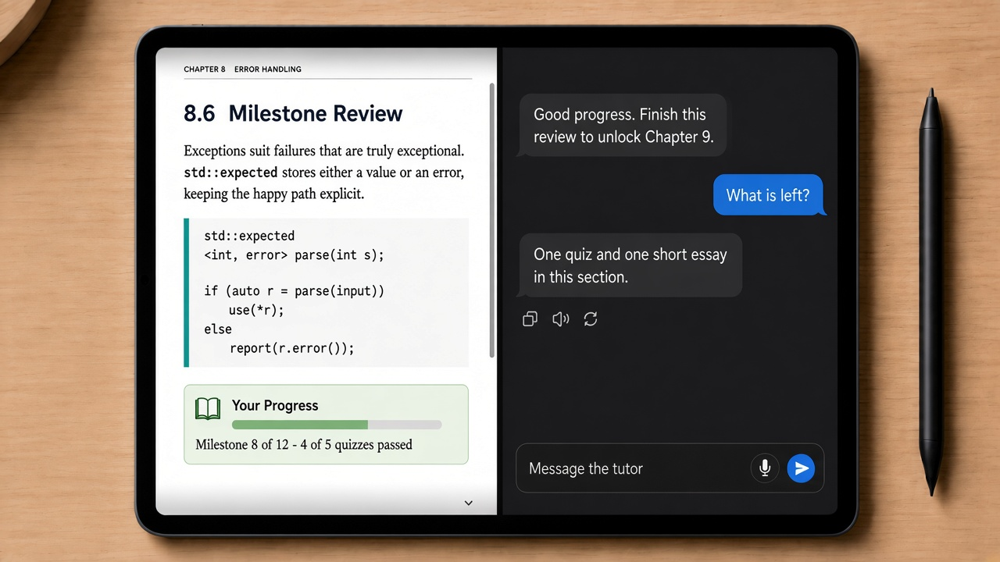

[](https://github.com/cppalliance/pedagogue/actions/workflows/ci.yml)
[](LICENSE)
[](https://github.com/cppalliance/pedagogue/releases/latest)

# Pedagogue

Pedagogue is a "living textbook": a textbook page on the left and a tutor chat on the right. A model fills the page through a small set of page commands and talks with the student in the chat. The app is a Tauri 2 desktop window on an in-process Axum server, which delivers a TypeScript UI over loopback.




Concept renders from the design phase. The app follows the reference files in `design/`.

## Install

Download the file for your system from the [latest release](https://github.com/cppalliance/pedagogue/releases/latest):

- Windows: `Pedagogue_0.1.0_x64-setup.exe`
- macOS on Apple silicon: `Pedagogue_0.1.0_aarch64.dmg`
- macOS on Intel: `Pedagogue_0.1.0_x64.dmg`
- Debian 12, Ubuntu 22.04 and newer: `Pedagogue_0.1.0_amd64.deb`
- Other Linux distributions: `Pedagogue_0.1.0_amd64.AppImage`

`SHA256SUMS` on the same page holds the SHA-256 hash of each file.

The installers are unsigned, so each system asks before it opens one:

- **Windows.** Windows shows "Windows protected your PC". Choose More info, then Run anyway. The setup installs for the current user.
- **macOS.** Open the disk image and drag Pedagogue into Applications. macOS blocks the first launch. Open System Settings, then Privacy & Security, and choose Open Anyway beside the line about Pedagogue. If macOS reports the app as damaged, run `xattr -dr com.apple.quarantine /Applications/Pedagogue.app` and open it again.
- **Linux.** Install the package with `sudo apt install ./Pedagogue_0.1.0_amd64.deb`. For the AppImage, make the file executable with `chmod +x Pedagogue_0.1.0_amd64.AppImage` and run it.

## Run it

The desktop app, from the source:

```text
cargo run -p pedagogue-desktop
```

It opens one window and plays the straw poll lesson. Pass a script as the first argument to play another one, such as `cargo run -p pedagogue-desktop -- samples/contact-sheet.json`. It prints its loopback address, and a browser on that address shows the same lesson.

In a browser alone, with the server and the demo in one process:

```text
cargo run -p pedagogue-server --example serve
```

It prints the address to open and plays the straw poll lesson. Its options:

- `--script <file>` plays another sample, such as `samples/contact-sheet.json`.
- `--fast` plays the script with no waits between steps.
- `--port <number>` asks for a fixed port.
- `--ui <folder>` serves the UI files from a folder. Run `npm run watch` in `ui/` and pass `--ui ui/dist`, and a style edit shows on refresh.

A running app also takes one page command at a time, for trying a command by hand:

```text
curl -X POST http://127.0.0.1:<port>/commands -H "content-type: application/json" -d "{\"tool\": \"success\", \"args\": {\"text\": \"Nice work.\"}}"
```

## Check it

From the repository root:

```text
cargo fmt --all --check
cargo clippy --workspace --all-targets --all-features -- -D warnings
cargo test --locked --workspace --all-features
cargo doc --workspace --no-deps --all-features
```

Set `RUSTDOCFLAGS` to `-D warnings` for the docs build. A plain `cargo test` covers the three crates that need only Rust.

From `ui/`:

```text
npm install
npm run check
```

`npm run check` runs the type check, oxlint, Stylelint, Prettier and the tests. `npm test` builds the bundle first.

The dependencies, from the repository root, with `cargo-deny` and `cargo-audit` installed:

```text
cargo deny check
cargo audit
```

`deny.toml` holds the allowed licenses and sources. CI runs all of these checks on every pull request and on `master`. It also runs the Nu HTML Checker on the two design files and on the app's page.

## Build an installer

From the repository root:

```text
cargo installer
```

It builds the installers for this machine with the Tauri bundler and prints the path of each one. The files land in `target/installer/<target>/`:

- Windows (`x86_64-pc-windows-msvc`): `Pedagogue_<version>_x64-setup.exe`
- macOS on Apple silicon (`aarch64-apple-darwin`): `Pedagogue_<version>_aarch64.dmg`
- macOS on Intel (`x86_64-apple-darwin`): `Pedagogue_<version>_x64.dmg`
- Linux (`x86_64-unknown-linux-gnu`): `Pedagogue_<version>_amd64.deb` and `Pedagogue_<version>_amd64.AppImage`

`cargo installer --target <triple>` builds for another target of the same system. An Apple silicon Mac builds the Intel installer that way, after `rustup target add x86_64-apple-darwin`.

The build writes into `target/` at the repository root, or into the folder that `CARGO_TARGET_DIR` names.

What it needs:

- Node on the `PATH`, and `npm ci` run once in `ui/`. That installs the Tauri CLI at the version pinned in `ui/package.json`.
- On Linux, the packages `libwebkit2gtk-4.1-dev`, `libssl-dev`, `librsvg2-dev`, `patchelf` and `xdg-utils`.

The installers are unsigned, and the macOS app has an ad hoc signature.

## Release it

A release is a `vX.Y.Z` tag on `master` that names the workspace version.

1. Set the new version: `version` under `[workspace.package]` and the internal entries under `[workspace.dependencies]` in `Cargo.toml`, then `cargo check --workspace` for `Cargo.lock`, and `npm version <version> --no-git-tag-version` in `ui/`.
2. Add a `## [<version>] - <date>` section to `CHANGELOG.md`, and put the new file names into the Install section of this file.
3. Land the change on `master` through a pull request. The pull request builds and checks all five installers.
4. Tag the landed commit and push the tag to `cppalliance/pedagogue`:

```text
git tag -a v0.2.0 -m "Pedagogue 0.2.0"
git push <remote> v0.2.0
```

`.github/workflows/release.yml` then builds the installers again, checks each one on the runner that built it, starts each app to see the page in its window connect, and publishes them with `SHA256SUMS`. The section of `CHANGELOG.md` becomes the release notes. A tag that names another version than the workspace stops the run before anything is built. Only `cppalliance/pedagogue` publishes: the same tag in a copy of the repository builds and checks the installers and stops there.

## Sample scripts

A sample script is a JSON list of steps: page commands, chat lines, scripted student answers and a wait for Continue. The doc comment on `Script` in `crates/pedagogue-demo/src/script.rs` lists the shapes.

`samples/contact-sheet.frames.json` is written from `samples/contact-sheet.json`, and a test fails when the two disagree. After a change to the sample or to the wire shapes, set the environment variable `PEDAGOGUE_UPDATE_FIXTURES` to `1`, run `cargo test -p pedagogue-demo`, and review the diff of the file.

## Layout

- `design/` - the two design reference files. The app must match them.
- `images/` - the concept renders shown at the top of this file and in `vision.md`.
- `crates/pedagogue-session/` - the lesson model, the chat transcript and the session handle that a host drives.
- `crates/pedagogue-demo/` - a sample script player and a stand-in tutor.
- `crates/pedagogue-server/` - the loopback server that delivers the UI and its socket.
- `crates/pedagogue-desktop/` - the Tauri app. Its binary is named `pedagogue`.
- `crates/pedagogue-installer/` - the build tool behind `cargo installer`. It makes the installers for Windows, macOS and Linux.
- `ui/` - the TypeScript UI, bundled by esbuild.
- `samples/` - sample scripts, as JSON. `straw-poll.json` is the lesson the app plays by default. `contact-sheet.json` draws every element of the two design files on one page, and `contact-sheet.frames.json` holds the frames the app sends for it.
- `.github/workflows/` - `ci.yml` runs the checks on every pull request and on `master`. `release.yml` builds and checks the installers, and publishes them when a `vX.Y.Z` tag is pushed.
- `.github/installers/` - the launch check of the release run: it starts an installed app and waits for the page in its window to connect.
- `.githooks/` - the pre-commit and pre-push hooks. `CONTRIBUTING.md` says how to turn them on.
- `plan/` - the plans that the repository was built from, each with a record of what its build found.

`ARCHITECTURE.md` explains how the parts fit together, `AGENTS.md` holds the rules for working in this repository, `CONTRIBUTING.md` says how to set up and what a pull request has to pass, and `CHANGELOG.md` lists the changes of each release.

## Toolchain

- Rust 1.99, pinned in `rust-toolchain.toml`.
- Node 24.15 or newer, with npm.
- The Tauri 2 prerequisites for your platform, for the desktop crate.

## License

Boost Software License 1.0. See `LICENSE`.
