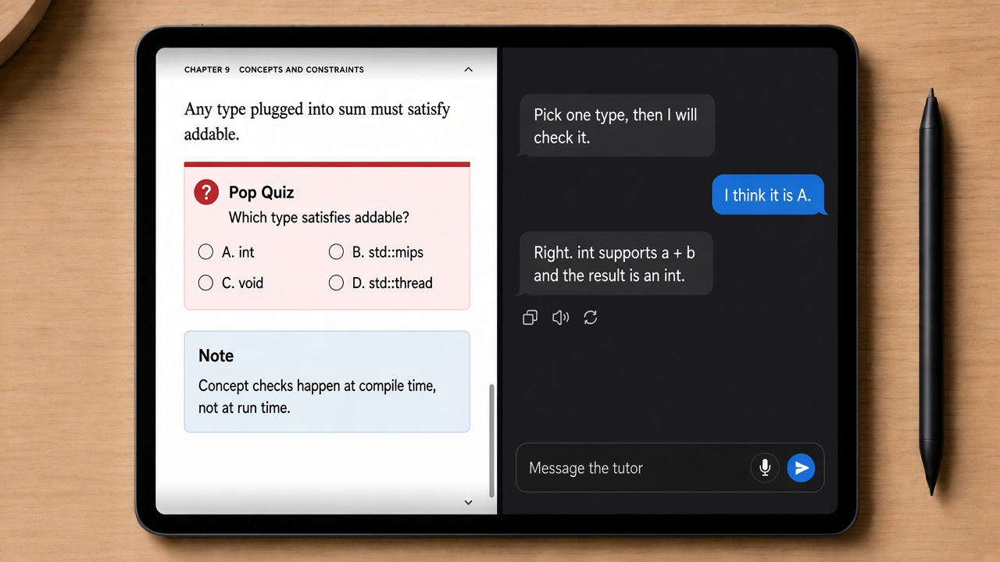

[](https://github.com/cppalliance/pedagogue/actions/workflows/ci.yml)
[](LICENSE)
[](https://github.com/cppalliance/pedagogue/releases/latest)

# Pedagogue

Pedagogue is a "living textbook": a textbook page on the left and a tutor chat on the right. A model fills the page through a small set of page commands and talks with the student in the chat. The app is a Tauri 2 desktop window on an in-process Axum server, which delivers a TypeScript UI over loopback.




Concept renders from the design phase. The app follows the reference files in `design/`.

## Run it

The desktop app:

```text
cargo run -p pedagogue-desktop
```

It opens one window and plays the straw poll lesson. Pass a script as the first argument to play another one, such as `cargo run -p pedagogue-desktop -- samples/contact-sheet.json`. It prints its loopback address, and a browser on that address shows the same lesson.

In a browser alone, with the server and the demo in one process:

```text
cargo run -p pedagogue-server --example serve
```

It prints the address to open and plays the straw poll lesson. Its options:

- `--script <file>` plays another sample, such as `samples/contact-sheet.json`.
- `--fast` plays the script with no waits between steps.
- `--port <number>` asks for a fixed port.
- `--ui <folder>` serves the UI files from a folder. Run `npm run watch` in `ui/` and pass `--ui ui/dist`, and a style edit shows on refresh.

A running app also takes one page command at a time, for trying a command by hand:

```text
curl -X POST http://127.0.0.1:<port>/commands -H "content-type: application/json" -d "{\"tool\": \"success\", \"args\": {\"text\": \"Nice work.\"}}"
```

## Check it

From the repository root:

```text
cargo fmt --all --check
cargo clippy --workspace --all-targets --all-features -- -D warnings
cargo test --locked --workspace --all-features
cargo doc --workspace --no-deps --all-features
```

Set `RUSTDOCFLAGS` to `-D warnings` for the docs build. A plain `cargo test` covers the two crates that need only Rust.

From `ui/`:

```text
npm install
npm run check
```

`npm run check` runs the type check, oxlint, Stylelint, Prettier and the tests. `npm test` builds the bundle first.

The dependencies, from the repository root, with `cargo-deny` and `cargo-audit` installed:

```text
cargo deny check
cargo audit
```

`deny.toml` holds the allowed licenses and sources. CI runs all of these checks on every pull request and on `master`.

## Sample scripts

A sample script is a JSON list of steps: page commands, chat lines, scripted student answers and a wait for Continue. The doc comment on `Script` in `crates/pedagogue-demo/src/script.rs` lists the shapes.

`samples/contact-sheet.frames.json` is written from `samples/contact-sheet.json`, and a test fails when the two disagree. After a change to the sample or to the wire shapes, set the environment variable `PEDAGOGUE_UPDATE_FIXTURES` to `1`, run `cargo test -p pedagogue-demo`, and review the diff of the file.

## Layout

- `design/` - the two design reference files. The app must match them.
- `images/` - the two concept renders at the top of this file.
- `crates/pedagogue-session/` - the lesson model, the chat transcript and the session handle that a host drives.
- `crates/pedagogue-demo/` - a sample script player and a stand-in tutor.
- `crates/pedagogue-server/` - the loopback server that delivers the UI and its socket.
- `crates/pedagogue-desktop/` - the Tauri app. Its binary is named `pedagogue`.
- `ui/` - the TypeScript UI, bundled by esbuild.
- `samples/` - sample scripts, as JSON. `straw-poll.json` is the lesson the app plays by default. `contact-sheet.json` draws every element of the two design files on one page, and `contact-sheet.frames.json` holds the frames the app sends for it.
- `.github/workflows/` - `ci.yml` runs the checks on every pull request and on `master`.

`ARCHITECTURE.md` explains how the parts fit together, and `AGENTS.md` holds the rules for working in this repository.

## Toolchain

- Rust 1.99, pinned in `rust-toolchain.toml`.
- Node 24.15 or newer, with npm.
- The Tauri 2 prerequisites for your platform, for the desktop crate.

## License

Boost Software License 1.0. See `LICENSE`.
