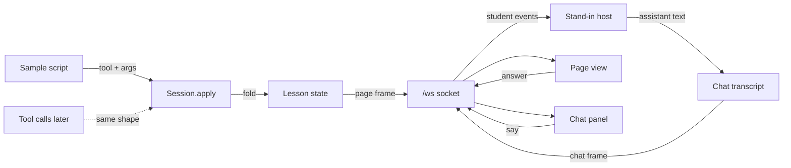
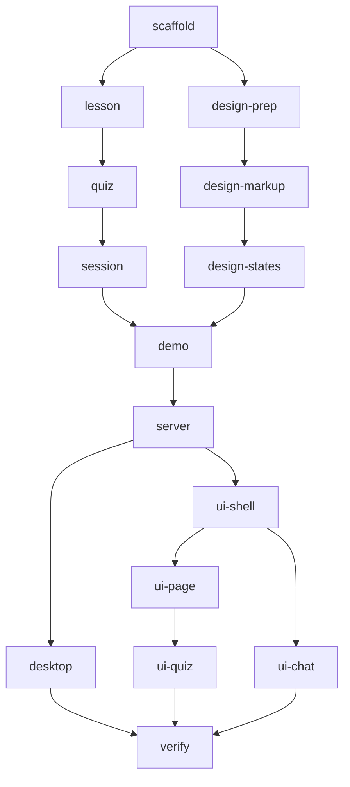

# Pedagogue desktop app: page commands and chat stub

## Start here

This plan is written for a reader who starts from this file alone.

- **What it is:** Pedagogue is a "living textbook". A textbook page sits on the left and a tutor chat on the right. A model will later fill the page through tool calls. This plan builds the app with a sample script and a stand-in tutor in the model's place.
- **Where things stand:** only the design exists. `pedagogue/` holds two design files, and every step below is still to do. The design files were written before the web rulebooks were applied, and the `design-markup` step brings them in line.
- **How to run it:** read this whole file, then do the steps in order. Each step lists what it uses, what to read first, what to do and when it is done. Mark a step's todo done when its commit lands, and add every design change to the log at the bottom.
- **Workshop is the model to copy.** Runvil Workshop, in `runvil-workshop/`, is this team's desktop app with the same architecture. Each step names the Workshop files to read. Copy the pattern and leave Workshop's own features behind: the gateway, plugins, registry, updater, custom title bar and health polling.
- **Four rulebooks bind the code.** Before writing or reviewing a language, load its rulebook: [tools-public/rulebooks/rust-rulebook.md](tools-public/rulebooks/rust-rulebook.md), [tools-public/rulebooks/typescript-rulebook.md](tools-public/rulebooks/typescript-rulebook.md), [tools-public/rulebooks/javascript-rulebook.md](tools-public/rulebooks/javascript-rulebook.md) and [tools-public/rulebooks/html-css-rulebook.md](tools-public/rulebooks/html-css-rulebook.md). When sources disagree, the order is: the user's decisions in this plan, then the rulebooks, then Workshop's habits. "The Rust rulebook, applied" and "The web rulebooks, applied" list where that order changed something.
- **Vocabulary:** Runvil is the team's agent framework, spelled "Runvil". A Host is an app that runs prompts through it, which Pedagogue becomes in a later plan. The student is the person learning. The tutor is the model, played here by a stand-in.
- **Earlier conversation:** [Pedagogue design and plan](2b1e8b57-c3b2-4cea-a3ea-33570fd43ea1) holds the full history, for the rare question this file leaves open.

## State at handoff (2026-11-21)

- `pedagogue/` is a git repo on `master` with zero commits and a local-only history. It holds `design/page-contact-sheet.html`, `design/chat-panel.html`, `design/.gitignore` (which ignores `scratch/`) and `design/scratch/` with 28 reference renders.
- Tools on this machine: rustc and cargo 1.99.1, Node 24.19.0, npm 11.17.0, git 2.56, `cargo tauri` 2.12.0, Python 3.13 with Pillow, and Chrome at `C:\Program Files\Google\Chrome\Application\chrome.exe`. The shell is PowerShell on Windows. Cargo has only its stock commands here, so `cargo deny`, `cargo audit` and `cargo nextest` wait for the CI plan.
- Cargo's cache already holds axum 0.8.9, rust-embed 8.12.0, tauri 2.11.5 and tokio-tungstenite 0.29.0. `npm install` needs the network.
- Read from the npm registry on 2026-11-21: `typescript` 7.0.2 is the newest release, and it is the one Workshop pins. `typescript-eslint` 8.73.0 supports TypeScript from 4.8.4 up to, but excluding, 6.1.0, and its docs say the same. So the UI is linted by `oxlint` 1.94.0 with its type-aware backend `oxlint-tsgolint` 7.0.2008. oxlint's docs say that backend runs on the TypeScript 7.0 engine and supports 60 of typescript-eslint's 62 type-aware rules. Also current: `prettier` 3.10.1, `stylelint` 18.1.0, `stylelint-config-standard` 41.1.0, `zod` 4.6.7 and `highlight.js` 11.12.0. Stylelint accepts Node 24.19.

## Rules for this build

- **Workspace rules load on their own.** They cover writing style, file routing and moving files to `cabinet/_trash` in place of deleting them. Their run-a-plan rule asks for a step and data-flow check before starting, and the Steps section is laid out for that.
- **Match the design.** See "The design files are the reference".
- **Built to change.** See the section of that name.
- **Commits:** one per step on `master`, on this machine only. Read [.cursor/rules/commit.mdc](.cursor/rules/commit.mdc) before writing a commit message. Stay on `master`. Before every commit that touches Rust, the format check and the clippy line under "Checks" pass. Once `ui/` exists, every commit that touches `ui/` or `design/` passes `npm run check` first. A formatting-only change gets its own commit.
- **Stop rule:** if a step's checks fail twice, stop and re-plan with the user.
- **Docs:** this plan approves `README.md`, `AGENTS.md` and `ARCHITECTURE.md` in `pedagogue/`. Those three are the only documentation files to create.
- **Scope:** build what the steps say. "Later plans" lists what waits.
- **Finish:** report every design change with its reason.

## Design decisions already made

The user settled these over many rounds. Keep them.

- The page and the chat sit side by side at every window size. The page stays beside the chat, never above it.
- The page is white with serif text. The chat is dark.
- Chat bubbles follow iMessage: gray tutor bubbles on the left, blue student bubbles on the right, and a tail on the last bubble of a run.
- One small icon row (copy, read aloud, regenerate) sits under the newest tutor bubble.
- Box colors have fixed meanings: blue is information and common, yellow is a personal note, red is a quiz, green is progress and rare.
- A quiz box has a pale rose fill, a thin soft outline, a thick left bar, a plain title, and its buttons on the right.
- Inline code is tinted to match the box it sits in.
- Every paragraph starts with a normal-size letter. The drop cap was removed.
- The page scrolls vertically, with a cue at the top and the bottom when more content lies that way.
- The renders in `design/scratch` are AI-made references for the layout, and their small text is unreliable. Where a render and the HTML differ, the HTML wins.

## The design files are the reference

[pedagogue/design/page-contact-sheet.html](pedagogue/design/page-contact-sheet.html) and [pedagogue/design/chat-panel.html](pedagogue/design/chat-panel.html) are the design, and the app must match them.

- **Look:** the CSS lives in separate files, one beside each component in `ui/src`. The design files link those same files and the app bundles them, so the look has one home and an edit shows in both. A test checks that each design file links every CSS file on its side. The icons stay in each design file's sprite, where a browser opening the file from disk can reach them, and `ui/build.mjs` reads them from there.
- **Markup:** `samples/contact-sheet.json` reproduces the page file and the chat file's live panel, state for state. Tests compare what the app draws with the HTML, element by element: the same tags and classes in the same order, plus the `type`, `disabled`, `checked`, `aria-pressed` and `aria-hidden` attributes. The chat file's other labeled states are reached by driving the panel in the test.
- **Rules:** both files follow the HTML and CSS rulebook, and so does everything the app draws. One set of checks, in `ui/test/helpers/html-rules.mjs`, runs over the two files and over the app's page.
- **Every state has a sample.** Each state the app can draw appears on a sheet. The two exceptions are the status area under a free-text box, which is shown once and reused under the other two boxes, and the top of a later page, which is the opener's top with the chapter title hidden from view.
- **By eye:** at the end, the app and the two files are screenshotted side by side at the same width.
- **Changes:** the known changes land in the design files first, in `design-prep`, `design-markup` and `design-states`, so the app is built against the final design. Any later change goes into the HTML in the same commit as the app change. Each change and its reason goes into "Design changes" at the bottom of this plan as it is made.
- **Scope:** the design is the page inside `.page` and the chat inside `.panel`. The sheets' own framing stays on the sheets: desk background, card size and shadow, header, swatches, section bands, class labels and the small scroll-cue sample.
- **Marks:** `data-sheet` marks a framing element that the tests skip whole. `data-sheet-wrap` marks a framing wrapper that the tests see through to its children.
- **Layout:** the two files show each side alone, so the split follows the renders in `pedagogue/design/scratch`: half and half, with the chat growing to 520px at most. On a wider window the page takes the extra width and keeps its text column at the design's 620px, centered. The window opens at 1280 x 860, and its smallest size is 960 x 640.

## Built to change

None of this is set in stone. The quiz rules, the wording, the look and the command list will all be adjusted during user trials, so the code keeps each kind of decision in one place:

- **Rust decides, the UI draws.** Every quiz rule runs in Rust. The UI sends the student's picks and draws the state it gets back: which options are open, disabled or right, and which feedback to show. A rule change is a Rust edit that leaves TypeScript and the wire as they are.
- **Quiz rules sit in one file**, `crates/pedagogue-session/src/lesson/quiz_rules.rs`, as plain functions: given the quiz, the attempts so far and the new attempt, they return what the page shows next. A rule that needs a new look, such as a cap on attempts with a locked state, is that edit plus one new state in the design file.
- **Wording has two homes.** Fixed text the student reads (box titles, button labels, "Not quite") is in `ui/src/wording.ts`. Text the model reads (receipts, refusals, reports of student actions) is in one `wording.rs` in each Rust crate that writes it.
- **Look sits in the CSS files**, one beside each component. The design files and the app both read them, so restyling a component is an edit to one file. Every color is a token in `tokens.css`, so a palette change is an edit there, and a test keeps its contrast.
- **Commands are cheap to add or reshape.** A command is an args struct and one arm of the fold, and most new elements reuse an existing block kind. Formats change freely: lesson state lives in memory, so every run starts from the current shapes.
- **Sample scripts are JSON**, so a new page can be tried by editing a file and replaying it.

The repo's `AGENTS.md` states the standing rules, so later work follows them: built to change, match the design, the UI import rule, comments only for a non-obvious why, and the four rulebooks.

## How it fits together



- **The binary owns the session.** It creates one `Session`, hands a clone to the server and a clone to the demo, and gives the demo the stream of student events. It also owns the one async runtime that the server and the demo run on.
- **State lives in Rust.** `Session::apply` checks a command, folds it into the lesson and wakes the socket. The fold also numbers figures and footnotes, so the UI only draws what it is sent.
- **The answer key stays in Rust.** The page view sent to the UI holds option states. Which option is right, and the feedback for options the student has yet to pick, stay in Rust until the rules release them.
- **The socket sends whole states.** A `page` frame holds one page and a `chat` frame holds the chat. Each connection keeps a cursor, and a wake-up sends whatever changed since. The next wake-up delivers everything since the cursor, so a missed one costs only a moment, and a slow client slows only itself.
- **The UI redraws only what changed.** It matches blocks by id, draws the new or changed ones and leaves the rest alone, which keeps whatever the student is typing.
- **Markdown becomes HTML in TypeScript.** `marked`, then DOMPurify, as in Workshop's [runvil-workshop/crates/workshop/ui/src/parts/agent/markdown-render.ts](runvil-workshop/crates/workshop/ui/src/parts/agent/markdown-render.ts). Every text field in a command is markdown, and one-line fields such as a quiz question render inline. Raw HTML and images are stripped in this build. This is the one place where HTML enters the page, and all other text goes in as plain text.
- **Student actions go up the same socket.** A chat message, a quiz attempt (right or wrong) or a press of Continue is recorded in the session and comes out as one stream of student events for the host.

## The Rust rulebook, applied

[tools-public/rulebooks/rust-rulebook.md](tools-public/rulebooks/rust-rulebook.md) governs all Rust here, and its seven binding rules hold as written. This section says how its other rules land in this repo. Every crate here is internal and unpublished, so its publishing rules (semver checks, docs.rs metadata, an MSRV matrix) start to apply when a crate is first published.

Where it changes what Workshop does:

- **Crates:** four, each split for a reason the rulebook accepts. `pedagogue-session` is the core and the seam for hosts, kept free of Axum and Tauri. `pedagogue-demo` is kept apart so the stand-in can use only what a real host could. `pedagogue-server` isolates Axum and the Node build. `pedagogue-desktop` isolates Tauri. The lesson model is a module of the session crate, since a crate of its own would only force its internals public.
- **Directories** are named exactly like their crates, in one flat `crates/` matched by a glob.
- **One runtime, chosen by the binary.** The libraries expose plain async functions and leave spawning to their caller. The desktop binary runs them on Tauri's async runtime, which is tokio, and the `serve` example runs them on its own tokio runtime. Workshop gives its server a thread and a runtime of its own, and the rulebook asks for one runtime per process.
- **`unsafe_code` is `forbid`**, since every crate here is safe Rust. If a macro in the desktop crate trips it, the level drops to Workshop's `deny` and the final report says so.
- **Docs and doctests:** every public item has a doc comment in the rulebook's style, every public function that returns `Result` has `# Errors`, and every public function, method and type has an `# Examples` doctest. Examples that open a socket or a window are `no_run`. Workshop bans doctests to keep its gate fast, and the rulebook requires them, so here they stay on.
- **Tests:** unit tests sit in a `#[cfg(test)] mod tests` at the bottom of the file under test. Tests through a crate's public API sit in one binary at `tests/it/main.rs`, with shared helpers in `tests/common/mod.rs`. Every test waits on an event, never on a sleep: async tests run on paused time, and tests against a live server run on real time with a timeout on each read, since a paused clock fires timers early while a socket is in flight.
- **Manifest:** `version = "0.0.0"` and `publish = false` on every crate, `rust-version` in `[workspace.package]` set to the pinned toolchain, every dependency declared once in `[workspace.dependencies]` (the four crates of this repo included, each with `path` and `version`), default features switched off where unused, and `Cargo.lock` committed. `repository` joins once a remote exists.

How its design rules shape the code:

- **Small public surface.** Items default to `pub(crate)`. The session crate's public API is the `Session` handle, the frames, the student events and the error types. The command structs stay private, since callers hand in a name and JSON. Each keeps a doc comment written for a model, ready for the schema work later. A frame is public as a value that serializes, and its fields stay private until a host needs to read them.
- **Errors:** one error type for each kind of failure: a refused command, a refused student action, a script that cannot play, a listener that cannot bind. Each is an opaque struct over a private `thiserror` enum, with `Display` as a lowercase phrase and its cause attached as a source. A refused command also answers `refusal()`, the full sentence the model reads, and `kind()`, which the server maps to a status. Binaries and the example use `anyhow` and print the whole chain. An error is logged or returned, and the layer that handles it is the one that logs it.
- **Types over checks:** ids and counters are newtypes (`BlockId`, `PageNumber`, `Version`), and each command's arguments turn into its block through a checked conversion, so a stored block is always valid.
- **Shared state:** the session is one `std::sync::Mutex` taken in short non-async methods, the rulebook's pick for a short critical section. A poisoned lock hands back its guard through `PoisonError::into_inner`, Workshop's habit, which is sound here because the fold checks a command before it changes anything. `Session` implements `Debug` and has a compile-time check that it is `Send` and `Sync`.
- **Channels** are bounded, and bounded sends form a line, never a loop: the socket task sends to the host, and the host answers through the session's lock and wake-up.
- **Shutdown:** one signal reaches every task. The server and its socket tasks end on it, the binary drops the demo's future on it, and the binary waits for what it spawned.
- **Test seams:** the clock is a plain closure. A trait waits until a second implementation exists.
- **Modules:** `foo.rs` beside a `foo/` folder for its children, each file opening with a `//!` line, and `lib.rs` holding only docs, `mod` lines and re-exports.
- **Dependencies:** each crate added is one Workshop's manifest already pins, plus `tracing-subscriber 0.3`, which Workshop's lockfile holds. Confirm each name, version and feature list against Workshop's lockfile or docs.rs before adding it.
- **Build scripts:** the server's `build.rs` stays, because it generates the UI bundle. It writes only into `OUT_DIR` and lists its rerun inputs. The desktop crate's `build.rs` is the one Tauri requires.

Where this repo departs from the rulebook, and why:

- **License:** BSL-1.0, the team's license, in place of the dual MIT and Apache files.
- **serde** is a plain dependency of the session crate, since its frames exist to be serialized.
- **`#[non_exhaustive]`** stays off the public enums, such as the student events and the chat state. Every crate that matches on them lives in this workspace, and a new variant should stop the build until each one handles it. The attribute goes on when a crate gains a user outside this workspace.
- **Golden files** are plain JSON with an update switch, in place of `insta`, because the TypeScript tests read the same files.
- **`CHANGELOG.md` and `CONTRIBUTING.md`** wait for the first release and the first outside contributor. `ARCHITECTURE.md` is written now.
- **CI, `cargo deny`, `cargo audit`, `cargo nextest` and an `xtask` crate** wait for the CI plan. The repo is local-only today, and every command in this plan is plain cargo or npm.

## The web rulebooks, applied

Three more rulebooks from the same folder govern the UI, and their binding rules hold as written:

- [tools-public/rulebooks/typescript-rulebook.md](tools-public/rulebooks/typescript-rulebook.md) for everything in `ui/src`.
- [tools-public/rulebooks/javascript-rulebook.md](tools-public/rulebooks/javascript-rulebook.md) for `ui/build.mjs`, the config files, the tests and the two small scripts inside the design files. Its language rules hold in TypeScript too.
- [tools-public/rulebooks/html-css-rulebook.md](tools-public/rulebooks/html-css-rulebook.md) for the two design files, `ui/index.html`, every CSS file and the markup the app draws.

Where they change what Workshop does. Workshop's UI leans on the compiler and its own guard tests, and these rulebooks add tools on top:

- **Lint and format.** oxlint checks the TypeScript and the `.mjs` files, with its type-aware rules on. Prettier formats everything under `ui/` with its defaults. Stylelint checks the CSS with its standard set. `npm run check` runs them with the type check and the tests.
- **Schemas at the socket.** Every frame from the server passes a Zod schema in `protocol.ts`, and the TypeScript types are derived from those schemas. Workshop writes its guards by hand.
- **A strict content policy.** Scripts and styles come only from the app's own files. Workshop's policy also admits inline styles, for two libraries this app leaves out.
- **Markup and accessibility.** `design-markup` gives the design files semantic elements, real forms, labels and names, visible focus, AA contrast and a reduced-motion rule, and the app draws the same.
- **Cascade layers.** Every CSS file opens with the line `@layer reset, base, components, utilities;`, so the order of precedence is written down once and holds in any load order.

How their rules shape the code:

- **The compiler:** Workshop's `tsconfig.json` already sets `strict`, `noUncheckedIndexedAccess` and `verbatimModuleSyntax`. This repo adds `erasableSyntaxOnly`, which refuses `enum`.
- **Types:** data from outside arrives as `unknown` and passes a schema before use, which keeps `any` out. A closed set is an `as const` object or a union. An exported function states its return type. A type-only import says `import type`. Each file is imported by its own path, and a test refuses an `index.ts`. `as` appears only on a DOM lookup or after a schema, and a value that may be missing gets a check in place of `!`.
- **Failures and promises:** an expected failure is a value the caller branches on, such as a frame that fails its schema or a copy the clipboard refused. A throw marks a bug, and it throws an `Error`. Every promise is awaited, or detached on purpose with `void` and a `catch` that reports.
- **Ids:** block ids and page numbers are branded types that the schemas produce, the TypeScript side of the Rust newtypes.
- **Files and names:** kebab-case file names, one concept per file, verb-first function names, and `is` or `has` on booleans.
- **JavaScript:** `const` and `let`, `===`, and in the Node scripts ESM with full file names and the `node:` prefix. TypeScript imports leave the extension off, as the TypeScript rulebook's examples and Workshop do.
- **The DOM:** text goes in through `textContent`. HTML goes in at one place, `markdown.ts`, after DOMPurify, and a lint rule refuses `innerHTML` and its kin everywhere else. Each page and the chat panel listen with one `addEventListener` and find the target with `closest()`.
- **Scroll cues:** an `IntersectionObserver` watches a marker at each end of a page and lights a cue when content lies that way, which also covers a page that grows.
- **The document:** `ui/index.html` has a doctype, `lang`, the charset, a viewport, a title and a description, and loads the bundle as a module. The page pane is the one `<main>`, and the chat pane is an `<aside>`.
- **Headings:** every lesson page opens with one `h1`. Its text is the chapter title, or a fallback line from `wording.ts`. It is drawn large on a chapter opener and hidden from view on later pages. Pages off screen are `hidden`, so one `h1` is exposed at a time. The section title and the chat title are `h2`, and markdown headings land on `h2` and `h3`.
- **Forms:** a quiz is a `<form>` and its main button submits it. Options sit in a `<fieldset>` whose `<legend>` is the question, and a free-text field has the question as its `<label>`. An answered option is `disabled`.
- **Native first:** a `<progress>` element, a `<time>` on each time line, an `<ol>` for the timeline, and a `type` on every button. ARIA covers what HTML leaves to it: the live chat log, pressed states and names for icon-only buttons.
- **Names:** every control has a name. Icon-only buttons have `aria-label`, decorative icons have `aria-hidden`, and visually hidden text names the composer field, each message's speaker and the typing bubble.
- **Layers:** the reset sits in `reset`, element defaults scoped to a side sit in `base`, class rules sit in `components`, and the `visually-hidden` and `[hidden]` helpers sit in `utilities`.
- **Selectors and tokens:** component rules select by class, three levels deep at most. Stylelint refuses ids, `!important` and a class with an element prefix. Every color is a custom property in `tokens.css`, read with a bare `var()`.
- **Layout:** the split is a two-column grid as tall as the window, in `100dvh` over a `100vh` fallback. Components use flex or grid with `gap`.
- **Focus, contrast, motion and size:** every control shows a `:focus-visible` ring at 3:1 or better. Text meets 4.5:1, and field edges meet 3:1. One rule in `utilities` stills animations, transitions and smooth scrolling under `prefers-reduced-motion`. Every control's target is 24px or larger.
- **Guards:** tests keep the rules that the tools miss. `html-rules` checks headings, landmarks, labels, names, button types and inline handlers on both design files and on the app's page. `contrast` checks token pairs. `css-homes` checks the layer line and that colors live in `tokens.css`. The linter refuses an import cycle.

Where this repo departs from them, and why:

- **Linter:** oxlint, in place of ESLint with typescript-eslint. The user chose to stay on Workshop's TypeScript 7.0.2, and typescript-eslint supports TypeScript below 6.1. oxlint's type-aware mode runs on the TypeScript 7 engine, and it has the eight rules the TypeScript rulebook calls for and the JavaScript rulebook's core list. Its config lists those rules by name, since the `strictTypeChecked` and `stylisticTypeChecked` sets belong to typescript-eslint.
- **Test runner:** Node's own runner with `.mjs` test files, as in Workshop, in place of Vitest. The tests load the built bundle, the same files the app ships, so they are plain scripts that need only a runner, and Workshop's helpers are written for this one.
- **Color notation** stays hex, the form the user approved the palette in, in place of `oklch()`. New mixes use `color-mix(in oklab, ...)`.
- **One layout and one palette.** The two panes sit side by side at every size, with a white page and a dark chat. Both are the user's decisions, so the mobile-first and `prefers-color-scheme` rules wait for a second layout or palette.
- **Markdown tables** are drawn as markdown gives them, a header row and body rows. A `<caption>` joins when a table gets a command of its own.
- **The design files** stay hand-formatted and keep their framing styles and demo scripts inline. They open from disk, and their diffs should show only design changes. Prettier and Stylelint run inside `ui/`.
- **Skip link:** left out, because the page pane comes first in the document and focus starts in the main content.
- **Imports** stay relative, in place of path aliases, since the tree is two folders deep.
- **Loading:** the app is three small files from loopback, so critical-CSS inlining, compression and purging are left out.
- **The Nu HTML checker and CI** wait for the CI plan.

## Repo layout

```text
pedagogue/
  Cargo.toml  Cargo.lock  rust-toolchain.toml  rustfmt.toml  clippy.toml  .cargo/config.toml
  LICENSE (BSL-1.0)  README.md  AGENTS.md  ARCHITECTURE.md  .gitignore  .gitattributes
  design/      page-contact-sheet.html  chat-panel.html  scratch/ (renders, ignored by git)
  crates/
    pedagogue-session/   the lesson model, quiz rules, chat, frames and the Session handle
    pedagogue-demo/      sample script player and stand-in host
    pedagogue-server/    Axum router, /ws, embedded UI, bind and serve
    pedagogue-desktop/   the Tauri binary, named pedagogue
  ui/          TypeScript and esbuild, with each component's CSS beside it
  samples/     contact-sheet.json  contact-sheet.frames.json  straw-poll.json
```

- `pedagogue-server` and `pedagogue-demo` each build on `pedagogue-session` and stay independent of each other. `pedagogue-desktop` uses all three, and the `serve` example in the server crate reaches the demo as a dev-dependency.
- Inside the session crate, `src/lesson.rs` and its children in `src/lesson/` hold the commands, the fold and the quiz rules as pure data and logic. They import nothing from the session module or from tokio.
- Root files, the lint block and the dependency pins are copied from [runvil-workshop/Cargo.toml](runvil-workshop/Cargo.toml) and its sibling config files, trimmed to this repo: edition 2024, toolchain 1.99, `serde 1` with `derive`, `serde_json 1`, `tauri ~2.11`, `tauri-build 2.6.3`, `tauri-plugin-opener 2.5.5`, `axum 0.8` with only `http1`, `json`, `tokio` and `ws`, `tokio 1` with each crate naming the features it uses, `rust-embed 8` with `interpolate-folder-path`, `thiserror 2`, `anyhow 1`, `url 2`, `tracing 0.1`, `tracing-subscriber 0.3` for the two binaries, and for tests `tower 0.5` with `util`, `tokio-tungstenite 0.29`, `futures-util 0.3`, `tempfile 3` and tokio's `test-util`.
- `default-members` are the session and demo crates, so a plain `cargo test` runs with only Rust installed. The server and desktop crates need Node and the Tauri toolchain.
- The server's `build.rs` runs `ui/build.mjs` (esbuild) into `$OUT_DIR/ui-dist`, and rust-embed serves that folder. This is Workshop's flow from [runvil-workshop/crates/workshop/server/src/assets.rs](runvil-workshop/crates/workshop/server/src/assets.rs), with `build.mjs` as the only build script. The build reruns when `ui/src`, the `ui/` config files or the two design files change.
- Names: product `Pedagogue`, binary `pedagogue`, identifier `com.runvil.pedagogue`, crates `pedagogue-*`.

## Page commands

Each command is a serde struct with doc comments written for a model to read. Most commands add one block to the end of the newest page. `new_page` starts a page, `footnote` and `continue_button` set parts of the page's foot, and `quiz_result` marks an existing quiz.

- **Page**
  - `new_page` - `chapter_number`, `chapter_title`, `section_number`, `section_title`, all optional. Starts the next page and shows it.
- **Text**
  - `exposition` - `markdown`. Paragraphs, lists, tables, code blocks, quotes and sub-headings, written `##` and `###`. A plain paragraph is an `exposition` call.
  - `footnote` - `markdown`. Adds a numbered note at the foot of the page. `[^1]` in exposition text draws its marker.
- **Figures**
  - `bar_chart` - `caption`, `bars` (label, value, optional tone: `accent`, `neutral` or `negative`).
  - `tree_diagram` - `caption`, `rows` of labels, `edges` between labels.
  - `timeline` - `stops` (label, note).
- **Blue, information**
  - `tip` - `markdown`, optional `title` such as "Chair's Tip".
  - `key_idea` - `markdown`.
  - `remember` - `markdown`.
- **Yellow, personal**
  - `tailored_for_you` - `markdown`.
  - `hint` - `markdown`.
  - `milestone` - `number`, `markdown`.
- **Red, quizzes**
  - `pop_quiz` - `question`, `options` (text, correct, optional feedback), optional `multiple`. Multiple choice, or select-all-that-apply when `multiple` is set. Short options sit in two columns.
  - `short_answer` - `question`. The one-line "Check Your Understanding" box.
  - `short_essay` - `question`, `words`.
  - `try_it` - `task`, `code`, optional `language`.
  - `quiz_result` - `quiz`, `verdict` (`correct` or `incorrect`), `feedback`. Marks a submitted free-text quiz.
- **Green, progress**
  - `progress` - `done`, `total`, `label`.
  - `section_complete` - `markdown`.
  - `success` - `text`. The one-line strip.
- **Page end**
  - `continue_button` - `label`, such as "Continue to 3.3". Sets the button at the foot of the page.

The model sees 21 commands. The renderer sees nine block kinds: `exposition`, `callout`, `choice_quiz`, `response_quiz`, `bar_chart`, `tree_diagram`, `timeline`, `progress` and `success`. The fold turns `tip`, `hint`, `milestone` and the rest into a `callout` with a variant, and the UI maps each variant to its color, icon and title, as the design file shows them. Footnotes and the Continue label are fields of the page.

Titles and icons, as the design file shows them:

- `tip`: blue, the info icon, titled "Tip" unless a title is given. `key_idea` and `remember`: blue, the info icon, titled "Key Idea" and "Remember".
- `tailored_for_you` and `hint`: yellow, the star icon, titled "Tailored for you" and "Hint for you". `milestone`: yellow, the clock icon, titled "Milestone" with its number.
- `section_complete`: green, the check icon, titled "Section complete". `progress`: green, the book icon, titled "Your Progress", with a bar. `success`: a green strip with one line.
- Quiz boxes are titled "Pop Quiz", "Check Your Understanding" (short answer), "Short Essay" and "Try It". Their buttons read "Check answer", "Submit", "Run" (Try It) and "Try again". Their tags read "Correct", with a check mark, and "Not quite".

```rust
// crates/pedagogue-session/src/lesson/command.rs
#[derive(Debug, Clone, PartialEq, Serialize, Deserialize)]
#[serde(tag = "tool", content = "args", rename_all = "snake_case")]
pub(crate) enum Command {
    NewPage(NewPage),
    Exposition(Exposition),
    PopQuiz(PopQuiz),
    // one variant per command, each a small struct of fields
}

// crates/pedagogue-session/src/session.rs
impl Session {
    /// Applies one page command and returns its receipt.
    ///
    /// # Errors
    /// Returns a [`CommandError`] when the name is unknown, the arguments
    /// are invalid, or the command cannot apply to the lesson as it stands.
    pub fn apply(&self, tool: &str, args: serde_json::Value) -> Result<String, CommandError>;
}
```

### Rules of the fold

- **Ids:** block ids run `b1`, `b2` and so on across the lesson. Pages are numbered from 1.
- **Receipts:** one short sentence that names the new block's id, such as `Added pop quiz b7 to page 3.` That id is how `quiz_result` points at a quiz.
- **Refusals:** one short sentence that says what to fix. Args are strict, so an unknown field or a wrong type is refused by name. The sentence comes from the error's `refusal()`, and the error's `Display` stays a lowercase phrase for logs.
- **First command:** before the first `new_page`, every other command is refused with `No page yet. Call new_page first.`
- **Chapters:** `new_page` repeats the previous page's chapter fields when they are omitted. The big chapter title shows on page 1 and whenever the chapter differs from the previous page's.
- **Numbers:** bar charts and tree diagrams are numbered by chapter, such as "Figure 3.1". Footnotes are numbered per page.
- **Quiz checks:** `pop_quiz` takes 2 to 6 options. Single choice has exactly one right option, and multiple select has at least one. `quiz_result` is refused for a pop quiz, for an unknown id, and for a free-text box that has yet to receive an answer.
- **Continue:** `continue_button` replaces the page's earlier label.
- **Pages only grow.** Commands add to the newest page, and `quiz_result` is the one command that changes an existing block.

### Quiz rules (first rules, to be tuned in trials)

- The student picks an option and presses Check answer. That submits the attempt, right or wrong.
- The page judges it at once from the answer key held in Rust. A wrong pick is disabled and dimmed, with "Not quite" and that option's feedback, and the student picks again from the options that remain. The right answer stays hidden until the student picks it.
- Every attempt is recorded on the quiz block and sent to the host as `QuizAnswered`: the quiz id, the picks, right or wrong, and the attempt number. This is how the model learns of a wrong answer and rates the student.
- Multiple select (`multiple` on `pop_quiz`) uses checkboxes, and one press of Check answer submits the whole selection. First rule: picks that were wrong are disabled, right picks stay ticked, and the page says when a right option is still unpicked. This is the least settled rule.
- The doc comment on `pop_quiz` asks the model to write wrong-option feedback that explains the mistake and keeps the right answer to itself.
- Free-text quizzes follow the same path: each submission is an event, the box shows the answer as sent, and the model answers with `quiz_result`. A verdict of `incorrect` shows the feedback with Try again, which reopens the box.
- A student action aimed at an unknown id, a disabled option or a solved quiz comes back as an error and leaves the lesson as it was. The socket task logs it and reads the next frame.

## Shapes on the wire

Frames are JSON, tagged by `type`, in `snake_case`. They are defined once in the session crate (the frames in `frames.rs`, the page view they hold beside the lesson model) and mirrored in `ui/src/protocol.ts`. These are starting shapes. Change them freely while building, as long as the Rust types, `protocol.ts` and the fixtures move together.

Server to UI, a `page` frame (one whole page) and a `chat` frame (the whole chat):

```json
{ "type": "page", "page_count": 2, "page": {
    "number": 1, "chapter_number": 3, "chapter_title": "Chairing a WG21 Room",
    "section_number": "3.2", "section_title": "Taking a Straw Poll", "chapter_opener": true,
    "blocks": [
      { "id": "b1", "kind": "exposition", "markdown": "The chair states the question clearly." },
      { "id": "b2", "kind": "callout", "variant": "tip", "title": "Chair's Tip", "markdown": "Keep your eye on the timebox." },
      { "id": "b3", "kind": "choice_quiz", "question": "What should the chair do first?", "multiple": false,
        "status": "open", "attempts": 1, "missing": false,
        "options": [ { "text": "Restate the question", "state": "open", "checked": false },
                     { "text": "Count the room", "state": "disabled", "checked": false } ],
        "feedback": ["Counting comes after the room knows the question."] }
    ],
    "footnotes": ["Straw polls are non-binding."],
    "continue_label": "Continue to 3.3", "continue_pressed": false } }
```

```json
{ "type": "chat", "state": "awaiting_input", "suggestions": ["Take the quiz"],
  "entries": [
    { "kind": "assistant", "text": "Read this section, then try the quiz.", "at": 1795300000000 },
    { "kind": "user", "text": "Why five columns?", "at": 1795300060000 },
    { "kind": "notice", "text": "**Milestone 2 unlocked** - Section 2.2 is ready", "at": 1795300090000 } ] }
```

UI to server, the student frames:

```json
{ "type": "say", "text": "Why five columns?" }
{ "type": "answer", "quiz": "b3", "picks": [1] }
{ "type": "answer", "quiz": "b9", "text": "It casts to an rvalue." }
{ "type": "continue", "page": 1 }
{ "type": "regenerate" }
```

- **Option states:** `open`, `disabled` (a wrong pick, drawn with "Not quite") and `right` (drawn with the Correct tag). `checked` says which boxes stay ticked. A quiz's `status` is `open` or `solved`, and `missing` is true when a multiple-select attempt left a right option unpicked.
- **Free-text boxes:** a `response_quiz` block has a `variant` (`short_answer`, `short_essay` or `try_it`), a `status` (`open`, `submitted`, `right` or `wrong`), the `answer` as sent, and the tutor's `feedback`.
- **Contract, pinned from both sides:** `protocol.ts` has a Zod schema for each frame and block kind, and the TypeScript types are derived from the schemas. A frame that fails its schema is dropped with one warning that names the failing field. The frames file for the contact-sheet sample and a fixture of the student frames are each checked by the Rust tests and by the UI tests, so a field renamed on one side fails a test on the other. Workshop's [runvil-workshop/crates/workshop/ui/test/workshop-wire-fixtures.mjs](runvil-workshop/crates/workshop/ui/test/workshop-wire-fixtures.mjs) is the pattern.

## Chat interface

Functions on `Session`, for whatever plays the host:

- `assistant_message(text)` adds a gray bubble. The text is markdown.
- `notice(text)` adds a centered line such as "Milestone 2 unlocked". A bold lead is written with markdown.
- `set_state(Working | AwaitingInput)` drives the typing dots and the composer. The composer is disabled while the tutor replies, as in the design. A new session awaits input.
- `set_suggestions(list)` sets the chips. A chip sends its text as a student message.

The session stamps each entry with the time, from a clock handed in at creation so tests and fixtures are stable. The UI shows a time line before the first message and after a 15-minute gap.

Back from the student, as `StudentEvent` values on one bounded channel: `UserMessage`, `QuizAnswered`, `ContinuePressed`, `RegeneratePressed`. `QuizAnswered` fires on every attempt, wrong ones included. A full channel slows the one client that is sending.

Each event has one plain-text form, written for the model and kept in the session crate's `wording.rs`:

- `Quiz b7, attempt 1: chose B "Count the room". Incorrect.`
- `Quiz b9 (short answer), attempt 1: the student wrote "It casts to an rvalue."`
- `The student pressed "Continue to 3.3" on page 1.`
- `The student asked for the last reply again.`

## Server

- **Bind and serve:** `bind(port)` is a plain function. It opens `127.0.0.1` on the given port, or on one the OS assigns, and returns the listener, so the URL is known before any task runs. `serve(listener, session, options, shutdown)` is a plain async function that the binary runs on its runtime. It ends once `shutdown` resolves and the open sockets have closed, and each socket task watches the same signal and closes its socket.
- **Bounded stop:** the binary signals shutdown, waits for the serve task for a grace window at most, then drops it, so closing the app always finishes within that window. Workshop's [runvil-workshop/crates/workshop/server/src/serve.rs](runvil-workshop/crates/workshop/server/src/serve.rs) shows the bind-first idea and the bounded stop, on a thread and runtime of its own.
- **Shape:** one `routes()` function per feature (assets, socket, commands), joined in a thin `app.rs`. Refusals on the wire use one small crate-private error type with a status and a code per case, as in Workshop's `error.rs`.
- **Routes:** `GET /`, `GET /app.js` and `GET /app.css` serve the three named UI files. `GET /ws` is the socket. `POST /commands` takes `{ "tool", "args" }` and answers with the receipt or the refusal, for poking a running app by hand.
- **Guards**, from [runvil-workshop/crates/workshop/server/src/cross_site.rs](runvil-workshop/crates/workshop/server/src/cross_site.rs): the socket and command routes refuse a request marked cross-site, a request whose host is foreign, and a non-JSON body. The socket upgrade also checks the origin. Loopback covers `127.0.0.1`, `localhost` and `[::1]`, so a browser on either address works.
- **CSP** on every response, from [runvil-workshop/crates/workshop/server/src/csp.rs](runvil-workshop/crates/workshop/server/src/csp.rs), trimmed and tightened for this app: scripts and styles only from the app's own files, sockets to loopback, images from the app or `data:`. Workshop's policy also admits inline styles, Tauri's IPC and remote images, which this app leaves out. A test pins the exact policy.
- **Socket:** one task per connection owns the socket for reading and writing, as in Workshop's `workshop_socket.rs`. It sends every page and the chat on connect, then whatever changed since its cursor. Inbound frames have a size cap, and the server logs and skips a frame it cannot read. The task ends when the socket closes or the shutdown signal arrives.
- **UI files:** embedded from `$OUT_DIR/ui-dist` with rust-embed. An option serves the same three named files from a folder on disk, read with tokio's file functions, for the styling loop. A request path never becomes a file path.
- **Logging:** the libraries log with `tracing`. The `serve` example and the desktop binary install a plain stderr subscriber, each under the `#[expect(clippy::disallowed_methods, reason = "...")]` that the `clippy.toml` copied from Workshop asks of a binary entry point.

## Desktop

- Follows [runvil-workshop/crates/workshop/desktop/src/main.rs](runvil-workshop/crates/workshop/desktop/src/main.rs): the window is created in Rust on the server's URL, and the server stops when the app exits. The server and the demo run as tasks on Tauri's async runtime.
- `tauri.conf.json` has an empty window list and the icon list, as in Workshop's. Everything the page does goes through the server's socket, so Tauri's page API stays switched off and the window gets the default grant.
- Outside links open in the system browser, with the policy and tests of [runvil-workshop/crates/workshop/desktop/src/navigation.rs](runvil-workshop/crates/workshop/desktop/src/navigation.rs).
- Everything that can fail at startup (reading the script, binding the listener) runs before the window opens and is reported with its chain of causes.
- It plays the script named by its first argument, or the built-in straw poll sample, and prints its URL.
- The crate is `pedagogue-desktop`, and its binary is named `pedagogue`. It is a library whose `run()` sits in a module of its own, plus a thin `main.rs` that returns an exit code, the shape Tauri's mobile targets use.

## UI

```text
ui/src/
  main.ts  socket.ts  protocol.ts  markdown.ts  wording.ts  tokens.css  layout.css
  page/   page-view.ts  page.css  scroll-cues.ts  scroll-cues.css
          blocks/  one renderer per block kind, each beside its CSS
                   (exposition.css, callout.css, quiz.css, figures.css, progress.css)
  chat/   chat-view.ts  chat.css  composer.ts  composer.css  chips.ts  chips.css
```

- Plain TypeScript and DOM APIs, as in Workshop. Class names and structure come from the design files, and `layout.css` holds only the split between the two sides.
- One import rule: `page/` and `chat/` import the shared files and never each other, shared files never import a feature, and `main.ts` alone wires the two. State lives in the view objects, handed in through constructors, and module files hold constants. A source-text test enforces both, in the style of Workshop's [runvil-workshop/crates/workshop/ui/test/no-shared-ui.mjs](runvil-workshop/crates/workshop/ui/test/no-shared-ui.mjs).
- Each component imports its own CSS file, the house layout from Workshop. `tokens.css` holds the layer order, the reset, the two palettes scoped per side, and the two helpers. A CSS file styles only its own component's classes and opens with the layer-order line, so the files give the same result in any load order, whether a design file links them or the app bundles them.
- Blocks draw straight into the page as the same elements the design uses, each a direct child of the page. The view keeps each block's nodes by id.
- The page pane is the design's scroll viewport, with the top and bottom cues. Each page keeps its own element, so a half-typed answer and the scroll position are still there when the student pages back. The page on screen is the one exposed, and the others are `hidden`.
- A quiz is a form. Its submit event sends the student's frame, so the button and the Enter key do the same thing, and the page that comes back says which inputs are `disabled`.
- The running head and the page-end row are as in the HTML. Previous section goes back a page. The second button goes forward a page, and on the newest page it is the tutor's Continue button. A button shows only when it has somewhere to go, and Continue dims after a press until the next page arrives.
- New blocks leave the scroll position alone and light the bottom cue. A new page is shown at once when the student is on the newest page. A student reading an older page reaches it with the forward button.
- The chat header shows the chapter and section of the page on screen.
- Markdown headings: `##` and `###` become the design's two heading sizes, as `h2` and `h3`. A `#` is drawn as `h2`, deeper levels as `h3`, and an `h3` that has only the `h1` above it as `h2`, so levels step by one.
- Markdown, the rest: a table gets the design's table class, `scope` on its header cells and classes in place of `align` attributes. A fenced block becomes the design's code block with highlight.js mapped onto the five token colors. A link opens outside the app, with `rel="noopener"` and a visually hidden note that it opens a new window. `[^1]` becomes a footnote marker.
- The socket opens after both panes exist. It reconnects with a capped delay that resets when a frame arrives.
- Copy works. Read aloud and the mic show their visual states, as the chat design's live panel does. Regenerate sends its frame.
- Styling loop: edit a CSS file and refresh the design file in a browser to see it at once. `npm run watch` rebuilds `ui/dist`, and the `serve` example can serve that folder, so the same edit shows in the app on refresh.
- Tests load the built bundle into jsdom with a scripted socket, the pattern in [runvil-workshop/crates/workshop/ui/test/helpers/boot.mjs](runvil-workshop/crates/workshop/ui/test/helpers/boot.mjs). Each test starts a fresh page and checks one behavior, and the fakes sit at the edges: the socket, the clock, the clipboard and the observer.

## Demo

The script player and the stand-in host in `crates/pedagogue-demo` stand where the tutor will. Its one entry point is a plain async function that plays a script and then serves live events until its caller drops it.

A script is a JSON list of steps. Each step is one of:

- `{ "tool": "pop_quiz", "args": { ... }, "as": "poll" }` - a page command. The optional `as` names the block it creates, and a later step writes `"@poll"` wherever a quiz id goes.
- `{ "assistant": "..." }`, `{ "notice": "..." }`, `{ "suggestions": ["..."] }` - the chat functions.
- `{ "student": "..." }` - a student message, as if typed.
- `{ "answer": { "quiz": "@poll", "picks": [1] } }` or `{ "answer": { "quiz": "@essay", "text": "..." } }` - a student answer.
- `{ "wait": "continue" }` - pause until the student presses Continue.

How it behaves:

- The player plays steps a quarter second apart, so the page builds block by block. Tests and screenshots play with zero delay. A refused step stops the script and names the step.
- The player takes the events its own scripted steps cause, so a sample's chat shows exactly what the script wrote.
- The stand-in answers a live student message with the typing dots and then one fixed reply, such as "I am a stand-in. A real tutor answers here once Runvil is connected." It shows a live quiz attempt or a press of Regenerate as a notice that starts "Sent to the tutor:" and holds the exact text the model will be sent.
- A live press of Continue wakes a waiting script. With the script finished, the stand-in shows it as a notice too.
- `samples/contact-sheet.json` reproduces the two design files state for state, on one page. `samples/straw-poll.json` is a two-page lesson with a wait for Continue between the pages, built from the design file's sample text, and it is the script the app plays by default.
- `samples/contact-sheet.frames.json` holds the frames the app sends for the contact-sheet sample. A Rust test fails when the file is stale, and rewrites it when `PEDAGOGUE_UPDATE_FIXTURES=1` is set.

## Steps

An arrow means the later step uses what the earlier one delivers.



- Each step ends with its checks passing and one commit on `master`.
- The design is finished before the sample is written, and the Rust side is finished before the UI starts. Every UI step then has the final design files, the CSS files, the exact frames the app sends and a running `serve` example to look at.
- `desktop` comes before the UI steps on purpose: it proves the Tauri window, the server start and the first long build while the page is still a placeholder.
- Two pairs can run side by side: the three design steps beside `lesson`, `quiz` and `session`, and `ui-chat` beside `ui-page` and `ui-quiz`. The rest runs in order, since cargo builds share one target folder and commits share one index.

### 1. scaffold

- **Uses:** the design folder as it is, and Workshop's root files.
- **Read first:** the Rust rulebook's sections 1, 8 and 12, then [runvil-workshop/Cargo.toml](runvil-workshop/Cargo.toml) for the lint block and the pins, [runvil-workshop/clippy.toml](runvil-workshop/clippy.toml), [runvil-workshop/rust-toolchain.toml](runvil-workshop/rust-toolchain.toml), [runvil-workshop/rustfmt.toml](runvil-workshop/rustfmt.toml), [runvil-workshop/.cargo/config.toml](runvil-workshop/.cargo/config.toml), [runvil-workshop/.gitattributes](runvil-workshop/.gitattributes), [runvil-workshop/AGENTS.md](runvil-workshop/AGENTS.md), and in [runvil-workshop/crates/workshop/ui](runvil-workshop/crates/workshop/ui) the files `package.json`, `tsconfig.json` and `build.mjs`. For the UI tools: the TypeScript rulebook's sections 1 and 11, the JavaScript rulebook's sections 3 and 12, the HTML and CSS rulebook's sections 1 and 14, and oxlint's pages on its [config file](https://oxc.rs/docs/guide/usage/linter/config.html) and its [type-aware mode](https://oxc.rs/docs/guide/usage/linter/type-aware.html).
- **Do:**
  1. Commit `design/` exactly as it is, so every later design change shows as a diff.
  2. Root files: a virtual `Cargo.toml` (`members = ["crates/*"]`, resolver 3, the `default-members` above, `[workspace.package]` with `version = "0.0.0"`, edition 2024, `rust-version = "1.99"`, license BSL-1.0 and `publish = false`, Workshop's three lint tables with `unsafe_code` raised to `forbid`, and `[workspace.dependencies]` holding only the crates this repo uses, with default features off where unused, plus the four crates of this repo by `path` and `version`; Workshop's dylint table stays behind), `rust-toolchain.toml`, `rustfmt.toml`, `clippy.toml`, `.cargo/config.toml` (the Windows linker section and the `[env]` section), `LICENSE` copied from Workshop, `.gitignore` (`/target`, `/ui/node_modules/`, `/ui/dist/`, `/crates/pedagogue-desktop/gen/`), `.gitattributes` (LF for text, images as binary). Commit `Cargo.lock`.
  3. `AGENTS.md`, kept short: the spelling "Runvil", the standing rules, and two rules from Workshop's file: formats change freely, and messages a model may read are short and say what to fix. For each of the four languages it names the rulebook as the law, restates that rulebook's binding rules in a line each so the file stands alone, says where the full rulebooks live in the workspace, and lists this plan's departures.
  4. `README.md`: what the app is, how to run and check it, the folder layout, the toolchain it needs and the license. `ARCHITECTURE.md`: the bird's eye view, a code map of the crates and the UI folders, the named invariants (Rust decides and the UI draws, the answer key stays in Rust, one home for the look, pages only grow, HTML enters the page in one place), and the concerns that cut across crates (wording, errors, logging, tests). Later steps keep its code map current.
  5. Four crates under `crates/`, each in a directory named like the crate, with a manifest (a one-line `description`, the shared package fields inherited, `[lints] workspace = true`) and a `lib.rs` that holds only its crate doc. The desktop crate declares its binary as `pedagogue` and gets a `main.rs` that does nothing yet. Each stub stays free of dependencies until its own step, so the whole workspace builds and lints from this commit on.
  6. `ui/package.json`: private, `"type": "module"`, and the scripts `build`, `watch`, `typecheck`, `lint` (oxlint, then Stylelint), `format`, `format:check`, `test` and `check`, which runs `typecheck`, `lint`, `format:check` and `test` in that order. Dependencies: `marked`, `dompurify`, `highlight.js` and `zod`. For development: `esbuild`, `jsdom`, `typescript` and `@types/node` at Workshop's versions, and `oxlint`, `oxlint-tsgolint`, `prettier`, `stylelint` and `stylelint-config-standard`. Confirm each name and version on the npm registry before adding it.
  7. The UI's config files. `tsconfig.json` is Workshop's with `erasableSyntaxOnly` added. If TypeScript 7 turns that flag down, a guard test refuses `enum` in its place. `.oxlintrc.json` turns the type-aware mode on, adds the `import` plugin to the default set, and sets the `correctness` and `suspicious` categories to errors. It then names these rules as errors. From the TypeScript rulebook: `no-floating-promises`, `no-misused-promises`, `await-thenable`, `no-explicit-any`, the five `no-unsafe-*` rules, `consistent-type-imports`, `restrict-template-expressions`, `switch-exhaustiveness-check`, `explicit-module-boundary-types`, `no-non-null-assertion` and `only-throw-error`. From the JavaScript rulebook: `eqeqeq` in its `smart` form, `no-var`, `prefer-const`, `no-throw-literal` and `no-undef`, with `env` set to `browser` for `src/` and `node` for the `.mjs` files. oxlint files `no-undef` with its unfinished rules, so drop that one if it misfires and say so in the step report. For the import rule: `import/no-cycle`. `no-restricted-properties` refuses `innerHTML`, `outerHTML` and `insertAdjacentHTML`, and an override lifts it for `src/markdown.ts`. `stylelint.config.js` takes the standard set, refuses ids, `!important` and a class with an element prefix, and caps a selector at three levels. `.prettierignore` names `dist/`.
  8. The UI's first files: `build.mjs` (bundle `src/main.ts` into `app.js` and `app.css`, copy `index.html`, take an output folder and a watch flag), `index.html` with the document setup from "The web rulebooks, applied" and the two panes, a placeholder `src/main.ts` with `src/layout.css`, Workshop's `src/css.d.ts` so the compiler accepts `.css` imports, and a first test that the build writes its three named files. Run `npm install` and commit the lockfile.
- **Done when:** the Rust checks under "Checks", `npm run build` and `npm run check` pass.

### 2. design-prep

- **Uses:** `scaffold`.
- **Read first:** both design files in full, and sections 9 and 10 of the HTML and CSS rulebook.
- **Do:**
  1. Screenshot both design files at full length before touching them. See "How to look at a page".
  2. Move every design rule into the CSS file of its component, in its final place under `ui/src`. Each design file keeps only its framing styles in one inline style block, placed after the links: the body, header, swatches, bands, labels and stage boxes, the card's size, shadow and outer border, and the box around the scroll-cue sample.
     - `tokens.css`: the layer order, the reset and both palettes.
     - `page/page.css`: the page column, running head, chapter title, headings, paragraphs, links, footnotes, the page-end row and the buttons.
     - `page/blocks/exposition.css`: lists, quotes, tables, code blocks, inline code and footnote markers.
     - `page/blocks/callout.css`, `quiz.css`, `figures.css` (figures, charts and the timeline) and `progress.css`.
     - `page/scroll-cues.css`: the viewport, the scroller and the cues.
     - `chat/chat.css`: the panel, header, messages, bubbles, time lines, notices, typing dots and icon row. `chat/composer.css` and `chat/chips.css` hold their own parts.
  3. Scope element rules as `:where(.page) p` and the like, so each rule weighs what it did before and stays out of the chat. Put the page tokens on `.textbook` and the chat tokens on `.tutor`, and give each sheet's `<body>` its class. Open every CSS file with the layer-order line, then put the reset in `reset`, these element rules in `base` and every rule that names a class in `components`. A rule with a class already outranks a rule made of element names alone, so the layers keep every result as it was.
  4. Split the rules that mix design and framing: `.page`, `.panel` and `.viewport`.
  5. Mark framing inside `.page`: `data-sheet` on the bands, the cue note and the scroll-cue sample, and `data-sheet-wrap` on the table's label wrapper.
  6. Make three changes that keep the look: chart colors move from SVG attributes into `figures.css`, the timeline's line is drawn from stop to stop in CSS so it fits any number of stops, and the gap between bubbles of one run moves from an inline style into `chat.css`.
  7. Name every color as a token in `tokens.css`, and have the component files read colors with a bare `var()`. The inline-code tint takes its default from a token set on the page, in place of its `var()` fallbacks.
  8. Bring the selectors in line with the rulebook's section 10: a class selector drops its element prefix (`h1.chapter-title` becomes `.chapter-title`), and a selector stops at three levels. The footnote marker's class becomes `fn-ref`, since `fn` is also the class of a code token. Format the CSS files with Prettier and clear what Stylelint reports.
  9. Link every CSS file of its side from each design file, `tokens.css` first.
  10. Import every CSS file from the placeholder `main.ts`, `tokens.css` first. Each component takes over its own import in the UI steps.
  11. In `build.mjs`, an esbuild plugin reads the icon sprite out of each design file and puts both into the built `index.html`. It stops the build when two icons share an id.
  12. Add `ui/test/css-homes.mjs`: each design file links every CSS file on its side, some TypeScript file imports every CSS file under `ui/src`, every CSS file opens with the layer-order line, and color values appear only in `tokens.css`.
  13. Check whether a browser opening a design file from disk shows an icon held in a second file. This plan assumes it refuses. If it allows it, tell the user, because the icons could then move to one shared file.
- **Done when:** the before and after screenshots of both files match, apart from the three animated spots in the chat file (typing dots, recording dot, read-aloud wave), and `npm run check` passes.

### 3. design-markup

- **Uses:** `design-prep`.
- **Read first:** the HTML and CSS rulebook in full, and sections 1, 6 and 9 of the JavaScript rulebook.
- **Do**, in both design files and the CSS files. The tags change and the look holds, except in items 5, 9 and 10:
  1. Screenshot both files first.
  2. **Structure, page file.** The sheet's own title becomes a paragraph, so the chapter title is the one `h1`. A `<main>` wraps the page, and `.page` becomes an `<article>`. The running head becomes a `<header>`, the footnotes a `<footer>`, the page-end row a `<nav>`, the timeline an `<ol>` with its dots drawn in CSS, and each callout title a `<p>`.
  3. **Structure, chat file.** A `<main>` wraps the samples. `.panel` becomes an `<aside>`, its head a `<header>` with the tutor's name as an `h2`, each time line a `<time>` and each notice a `<p>`. In both files the empty `<i>` shapes become `<span>`s with a class.
  4. **Quizzes as forms.** Each quiz box becomes a `<form>` whose main button submits it. A choice quiz holds its options in a `<fieldset>` with the question as the `<legend>`. A free-text quiz has the question as the `<label>` of its field. An answered option is `disabled`, in place of the `tabindex` and `pointer-events` pair.
  5. **Controls drawn in CSS.** Radios and checkboxes get `appearance: none` and their own open, checked, focused and disabled looks, so a disabled right answer stays crisp and every webview draws the same control. Their look changes slightly.
  6. **Native in place of ARIA.** The progress bar becomes a `<progress>` element. `role="radiogroup"`, `role="progressbar"` and the `aria-labelledby` attributes go, now that elements do their work. The table's header cells get `scope="col"`.
  7. **Names.** `tokens.css` gains the `visually-hidden` and `[hidden]` helpers in the `utilities` layer. The composer field gets a hidden `<label>`, each message a hidden speaker name ("Tutor" or "You"), and the typing bubble hidden text. Decorative icons get `aria-hidden`. The chips' wrapper gets `role="group"` to go with its label, and the recording timer stops announcing itself.
  8. **Inline styles, handlers and scripts.** `style` attributes inside `.page` and `.panel`, and the one on each icon sprite, become classes, since the app's content policy refuses them. `onsubmit` attributes become listeners. The two scripts follow the JavaScript rulebook: `const` and `let`, `querySelector`, and nodes built with DOM calls. Both files get a description.
  9. **Contrast.** New token values, each the nearest that passes: `--out` becomes `#0a73e0` (white text at 4.62:1, from 4.11), the chat's `--muted` becomes `#808088` (4.70:1 on the panel, from 4.44), the composer outline becomes `#6a6a72` (3.43:1 on the panel and 3.07:1 on its fill, from 1.58), and the page's field border becomes `#8c8484` (3.65:1 on white and 3.12:1 on the quiz fill, from 2.08). The page sheet's own gutter labels take `--ink-soft`.
  10. **Focus.** The composer shows focus as an `--accent` ring around the whole pill, in place of `outline: 0` and a faint border. The page's button ring becomes `#3f7fe0` (3.94:1 on white and 3.37:1 on the quiz fill, from 2.66), and the drawn radios and checkboxes get the same ring.
  11. **Motion.** One rule in `utilities` stills the typing dots, the recording dot, the read-aloud wave, the cue fade and smooth scrolling under `prefers-reduced-motion`.
  12. Add `ui/test/helpers/html-rules.mjs` and run it over both files from `ui/test/design-rules.mjs`. It checks for one exposed `h1` wherever a page is drawn, one `<main>`, heading levels that step by one, a `<label>` on every field, a `type` and a name on every button, and unique ids, and it refuses inline handlers and positive `tabindex` values. Add `ui/test/contrast.mjs`, which reads `tokens.css` and checks each text token against its background at 4.5:1, and field edges and focus rings at 3:1.
- Log each change with its reason under "Design changes". Show the user before-and-after crops of items 5, 9 and 10 in the step report, then keep going.
- **Done when:** the new screenshots match the old ones apart from items 5, 9 and 10, both files still open cleanly from disk, and `npm run check` passes.

### 4. design-states

- **Uses:** `design-markup`.
- **Do:** add these samples to `design/page-contact-sheet.html`, written in the markup that `design-markup` settled and styled in the CSS files:
  1. **Multiple choice after a wrong pick.** This replaces the "answered, wrong" sample. The wrong option is dimmed and disabled with its "Not quite" tag, the other options stay open, the feedback line shows, and Check answer stays for the next pick.
  2. **Multiple select**, three samples: before an answer (checkboxes and a "Select all that apply" line), after a wrong submission (the wrong pick disabled with "Not quite", a right pick still ticked, a line saying more remains), and solved (each right option tagged).
  3. **Free-text boxes after Submit.** A status area under the field, shown on the short-answer box in three states: sent (the answer read-only and a "Sent to your tutor" line), right (a tag and the tutor's feedback) and wrong (a tag, the feedback and Try again). The essay and Try It boxes reuse this status area.
  4. **Page-end row on an earlier page:** Previous section and Next section.
  5. **Numbers the app assigns:** the page number becomes 1, and the figures become Figure 3.1 and Figure 3.2.
- Log each change with its reason under "Design changes". Show the user a screenshot of each new state in the step report, then keep going.
- **Done when:** `npm run check` passes and both files still open cleanly from disk.

### 5. lesson

- **Uses:** `scaffold`.
- **Do**, in the `lesson` modules of `crates/pedagogue-session`, all crate-private:
  1. `lesson/command.rs`: the `Command` enum and one args struct for each of the 16 content commands, with `deny_unknown_fields` and doc comments a model can read.
  2. The lesson state and the fold: applying a command returns the receipt and the number of the page it touched, or a refusal. Each args struct becomes its block through a checked conversion.
  3. The page view the UI is sent, in the shape shown under "Shapes on the wire", with `BlockId` and `PageNumber` as newtypes.
  4. `wording.rs`, at the crate root: every receipt and refusal sentence.
  5. Nothing public reaches these modules until `Session` lands in the `session` step, so `lib.rs` declares the module as `#[cfg_attr(not(test), expect(dead_code, reason = "..."))] mod lesson;`, and gives `wording` the same line if the compiler asks for it. The expectation turns into an error once the code is in use, which is the cue to delete it.
- **Tests**, as unit tests in each file: each command's block, the receipts, every refusal, figure and footnote numbers, and chapter fields repeating.
- **Done when:** `cargo test -p pedagogue-session` and clippy pass.

### 6. quiz

- **Uses:** `lesson`.
- **Do**, in the `lesson` modules of `crates/pedagogue-session`:
  1. Add `pop_quiz`, `short_answer`, `short_essay`, `try_it` and `quiz_result`.
  2. Add the student-side calls: answer a choice quiz with picks, answer a free-text box with text, and press Continue. Each returns an error for an action that fits no open quiz, and leaves the logging to its caller.
  3. `lesson/quiz_rules.rs`: the rules as plain functions, and the attempt history on each quiz.
  4. The quiz views, with option states and the released feedback.
- **Tests**, as unit tests in each file: a wrong pick is disabled, the multiple-select first rule, the free-text path through `quiz_result`, every refusal and every refused action, and one test that the serialized page view holds neither the answer key nor unreleased feedback.
- **Done when:** `cargo test -p pedagogue-session` and clippy pass.

### 7. session

- **Uses:** `quiz`.
- **Do**, in `crates/pedagogue-session`:
  1. `Session`, a cloneable handle over one lock, created with a clock closure. Creating it also returns the stream of student events. Delete the `dead_code` expectation from `lib.rs`.
  2. `apply(tool, args)`, the four chat functions, and the student entry points: say, answer, press Continue, regenerate. The entry points wait for room on the bounded event channel, with the lock released first.
  3. A version number that rises on every change, a `tokio::sync::watch` wake-up, and `changes_since(cursor)`, which returns the pages and the chat changed since that cursor.
  4. `frames.rs`: only the frame types, both ways.
  5. Add the text form of each student event to `wording.rs`.
  6. `fixtures/student-frames.json`: one example of each student frame, with a test that each one parses.
  7. The public surface: `lib.rs` re-exports only what a host and the server use. Each public item gets its doc comment, `# Errors` where it returns `Result`, and an `# Examples` doctest. The error types are the opaque ones described under "The Rust rulebook, applied". A compile-time check confirms `Session` is `Send` and `Sync`.
- **Tests:** unit tests for the version and cursor, the chat functions with the fixed clock, and each student entry point with the event it sends. One integration binary at `tests/it/main.rs` drives the public API alone and checks the fixture.
- **Done when:** `cargo test -p pedagogue-session` (unit, integration and doc tests), clippy and `cargo doc` pass.

### 8. demo

- **Uses:** `session` and `design-states`.
- **Do**, in `crates/pedagogue-demo` and `samples/`:
  1. The script types and the player, as described under "Demo".
  2. The stand-in host, and one plain async `run` function that plays a script and then serves live events until its caller drops it or the event stream ends. It spawns nothing, so its caller picks the runtime, and it holds nothing that needs a clean close.
  3. `samples/contact-sheet.json`, written against the finished design files, with scripted answers and `quiz_result` steps that reach every quiz state on the sheet.
  4. `samples/straw-poll.json`, with correct lesson text, embedded as the default script.
  5. `samples/contact-sheet.frames.json` and its test.
- **Tests**, on paused time: the player (names with `as`, the wait for Continue, a refused step), the stand-in's reply and notices, and in `tests/it/main.rs` the frames file.
- **Done when:** `cargo test -p pedagogue-demo` and clippy pass.

### 9. server

- **Uses:** `demo`, and through it the CSS files from `design-prep`.
- **Read first:** in [runvil-workshop/crates/workshop/server](runvil-workshop/crates/workshop/server): `build.rs`, `src/serve.rs`, `src/app.rs`, `src/error.rs`, `src/cross_site.rs`, `src/csp.rs`, `src/assets.rs`, `src/routes/assets.rs`, `src/workshop_socket.rs`, `tests/common/mod.rs` and `tests/it/workshop_socket.rs`.
- **Do**, in `crates/pedagogue-server`, everything under "Server", plus:
  1. The public surface is `bind`, `serve` and its options. Each gets its doc comment, `# Errors`, and a `no_run` example.
  2. `build.rs` runs `node build.mjs` with the output folder `$OUT_DIR/ui-dist`, lists its rerun inputs, and names the fix when `ui/node_modules` is missing.
  3. `examples/serve.rs`: a small binary with its own tokio runtime. It creates a session, binds, runs the server and the demo together, prints the URL, and takes a script path, a fast flag for zero step delay, a fixed port and a UI folder. It uses `anyhow` and returns an exit code.
- **Tests:** unit tests on the router with `oneshot` (the three UI files, the guards, the exact content policy on every response, `POST /commands` with a receipt and with a refusal, the folder option against a temp folder). In `tests/it/main.rs`, with a small typed test client in `tests/common/mod.rs`, tests against a served listener: frames on connect, a command arriving as a page frame, an answer coming back as page state and a student event, two clients seeing the same state, an unreadable frame skipped with the connection still up, and the serve future ending soon after the shutdown signal while a socket is still open. These run on real time, and each read has a timeout in place of a sleep.
- **Done when:** `cargo test -p pedagogue-server`, clippy and `cargo doc` pass, and the `serve` example shows the placeholder page in a browser with the design CSS loaded.

### 10. desktop

- **Uses:** `server`.
- **Read first:** in [runvil-workshop/crates/workshop/desktop](runvil-workshop/crates/workshop/desktop): `src/main.rs` (the window and the exit handling), `src/navigation.rs`, `tauri.conf.json`, `Cargo.toml` and `build.rs`.
- **Do**, in `crates/pedagogue-desktop`, everything under "Desktop", plus:
  1. Dependencies: `tauri`, `tauri-plugin-opener`, `url`, `anyhow`, `tracing-subscriber` and the three pedagogue crates, with `tauri-build` for the build script.
  2. Placeholder icons: draw a simple 1024 x 1024 PNG with Pillow, then run `cargo tauri icon` on it from `crates/pedagogue-desktop`.
  3. `run()`: read the script, create the session, bind the listener, spawn the server and the demo on Tauri's async runtime, then build the Tauri app, whose setup opens a window titled "Pedagogue" on the server URL. On exit it signals shutdown and waits for the server task for the grace window at most.
- **Done when:** `cargo run -p pedagogue-desktop` opens the window on the placeholder page, and the app exits cleanly when the window is asked to close (PowerShell's `CloseMainWindow()` does this and leaves the user's mouse alone). Screenshot the window.

### 11. ui-shell

- **Uses:** `server`.
- **Read first:** in [runvil-workshop/crates/workshop/ui](runvil-workshop/crates/workshop/ui): `src/services/workshop-socket.ts`, `src/services/protocol.ts`, `test/helpers/boot.mjs`, `test/workshop-wire-fixtures.mjs` and `test/no-shared-ui.mjs`. Then the TypeScript rulebook's sections 2 to 8, and the JavaScript rulebook's sections 4 to 6 and 9.
- **Do**, in `ui/`:
  1. `index.html`: the page pane as `<main class="textbook">` and the chat pane as `<aside class="tutor">`, and the place where the build puts the icon sprites.
  2. `layout.css`: the split as a two-column grid, as tall as the window.
  3. `protocol.ts`: a Zod schema for each frame and block kind, the types derived from the schemas, and branded block ids and page numbers. Zod runs with its `jitless` setting on, since the content policy refuses `eval`. Confirm that setting's name in Zod's docs.
  4. `socket.ts` and `wording.ts`, as described under "UI". The labels and titles are read off the design files, hidden names included.
  5. `main.ts`: build both panes, then open the socket.
  6. `test/helpers/boot.mjs` (jsdom, the built bundle, a scripted socket, and fakes for the clock, the clipboard and `IntersectionObserver`) and `test/helpers/skeleton.mjs`, which turns an element into its tags, classes and compared attributes, skips `data-sheet` and sees through `data-sheet-wrap`.
  7. The import test: the import rule and a refusal of any `index.ts`.
- **Tests:** every frame in the frames file passes its schema and goes through the app, a frame missing a field is dropped with one warning that names the field, each frame the socket sends equals its entry in the student-frames fixture, the import test, and the `html-rules` checks on the shell before its first page arrives.
- **Done when:** `npm run check` passes.

### 12. ui-page

- **Uses:** `ui-shell`.
- **Read first:** [runvil-workshop/crates/workshop/ui/src/parts/agent/markdown-render.ts](runvil-workshop/crates/workshop/ui/src/parts/agent/markdown-render.ts).
- **Do**, in `ui/src/page` and `ui/src/markdown.ts`:
  1. The scroll viewport with its cues, one scroller for each page. An `IntersectionObserver` on a marker at each end lights the cues, and the scroller of a page off screen is `hidden`.
  2. The page view: running head, chapter title block (hidden from view on a later page), section heading, blocks kept by id, footnotes, and the page-end row with paging and Continue. One listener on each page finds the pressed button with `closest()`.
  3. `markdown.ts`, as described under "UI". It is the one file that sets `innerHTML`.
  4. The renderers for exposition, callout, bar chart, tree diagram, timeline, progress and success. Each chart's SVG has `role="img"` and a label written from its caption and data. Quiz blocks draw in the next step.
  5. Bring the design file's hand-written samples in line with what markdown and the highlighter produce: the code sample gets a `code` element inside `pre` and the highlighter's coloring in the five token colors, list lead-ins become emphasis, and the sample link takes the attributes and hidden note the renderer writes. Log each change.
- **Tests:** a markup test for each labeled element on the sheet apart from the quizzes, the scroll-cue sample against the app's viewport, the paging and button rules, Continue sending its fixture frame, the heading rules (one `h1`, the hidden title of a later page, a `###` that follows the `h1`), a markdown table and link, and the `html-rules` checks on the drawn page.
- **Done when:** `npm run check` passes, and the contact-sheet sample in the `serve` example looks like the design file apart from the quizzes.

### 13. ui-quiz

- **Uses:** `ui-page`.
- **Do**, in `ui/src/page/blocks`: the choice quiz (single and multiple select) and the free-text boxes, each drawing the states the page sends and sending the student's frames. Each quiz is a form, and its submit event sends the frame. Field and label ids come from the block id.
- **Tests:** a markup test for every quiz sample on the sheet, the essay and Try It boxes after Submit checked against their own open sample plus the shared status area, each press (Check answer, Submit, Run, Try again) sending its fixture frame, Enter in a one-line field sending the same frame as its button, a half-typed answer surviving a page update, and the `html-rules` checks with every quiz state drawn.
- **Done when:** `npm run check` passes.

### 14. ui-chat

- **Uses:** `ui-shell`.
- **Do**, in `ui/src/chat`: the header, the messages with runs and tails, time lines, typing dots, notices, the icon row under the newest tutor bubble, the chips, and the composer with its four states. The message list keeps the design's live region, so a screen reader announces a new reply. Where the app's rules produce different markup from the hand-written sample, such as the bold lead of a notice, change the chat design file in the same commit and log it.
- **Tests:** markup tests against the live panel and each labeled state, Send, a chip and Regenerate each sending its fixture frame, the composer disabled while the tutor replies, and the `html-rules` checks on the panel.
- **Done when:** `npm run check` passes.

### 15. verify

- **Uses:** every step.
- **Do:**
  1. Run every check under "Checks".
  2. Serve `samples/contact-sheet.json` with zero delay and screenshot the app in a tall window. Screenshot the two design files at the same widths. Compare region by region and fix what differs, or log a design change when the app is right.
  3. Start the desktop app with the straw poll sample and drive it in a browser on its URL: send a message and see the blue bubble, the dots and the fixed reply, answer the pop quiz wrong and then right and see the wrong pick disabled and two notices with the text for the model, press Continue and see page 2, then page back and forward.
  4. Walk the same app by keyboard alone: Tab reaches every control in reading order, each one shows its focus ring, and Enter submits a quiz and sends a message.
  5. Screenshot the desktop window.
  6. Mark the todos done and write the final report: what was built, how to run it, every design change with its reason, and anything left open.
- **Done when:** every check passes and the report is written.

## How to look at a page

- **A design file:** headless Chrome worked today. Run `chrome.exe --headless=new --disable-gpu --hide-scrollbars --window-size=1280,6000 --screenshot=<out.png> file:///C:/Users/Vinnie/cursor/pedagogue/design/page-contact-sheet.html`, crop with Pillow and read the image.
- **The app in a browser:** run the `serve` example and point the same command at its URL. The page fills in over the socket after load, so add `--virtual-time-budget=5000`. That flag is untested on this machine. The fallback is the IDE browser tool, which opens `http://localhost:<port>/` and can click, type and screenshot.
- **A tall window**, such as 1280 x 7000, shows a whole page with the scrolling out of the way.
- The IDE browser tool refuses `file://` addresses, so design files go through headless Chrome.
- **The desktop window:** the computer-use screenshot tool.
- Keep screenshots in a temp folder outside the repo.

## Checks

- Rust, from `pedagogue/`, the rulebook's local loop: `cargo fmt --all --check`, `cargo clippy --workspace --all-targets --all-features -- -D warnings`, `cargo test --locked --workspace --all-features` (which also runs the doctests), and `cargo doc --workspace --no-deps --all-features` with `RUSTDOCFLAGS` set to `-D warnings`.
- UI, from `pedagogue/ui/`: `npm run check`, which runs `typecheck`, `lint` (oxlint, then Stylelint), `format:check` (Prettier) and `test` in that order. `test` builds the bundle first.
- Risks: the first Tauri build takes several minutes, `npm install` needs the network, and the markup tests are strict, so the design-change list will grow past the known items. The lint rules will also reshape code that is patterned on Workshop's, and oxlint's type-aware mode gets its first run on this machine in `scaffold`.

## Choices already settled

- Copy Workshop's architecture: in-process Axum, window on the loopback URL, esbuild bundle, rust-embed (confidence: high - it is the house pattern and matches "deliver the UI over an endpoint").
- The Rust rulebook outranks Workshop's habits where the two differ: four crates in place of five, one runtime chosen by the binary, doctests, and `unsafe_code` forbidden (confidence: high - the user asked for the rulebook to be applied).
- The three web rulebooks outrank Workshop's habits where they differ: a linter, a formatter, schemas at the socket and a strict content policy (confidence: high - the user asked for them to be applied).
- The UI stays on Workshop's TypeScript 7.0.2 and is linted by oxlint's type-aware mode, in place of the ESLint setup the rulebook names (confidence: high on the choice, which is the user's, since typescript-eslint supports TypeScript below 6.1. Medium on the tool, which is new to this team and gets its first run in `scaffold`).
- UI tests stay on Node's own runner, where the rulebooks prefer Vitest (confidence: medium - the tests load the built bundle, the same files the app ships, so they need only a runner).
- Accessibility changes the look in five small places: a deeper blue bubble, a clearer composer outline, a darker field border, stronger focus rings, and radios and checkboxes drawn in CSS (confidence: high on the need, since contrast and focus are binding rules, and medium on the exact shades, which are the nearest that pass).
- The chapter title is the `h1` of every page, hidden from view after the opener (confidence: medium - one `h1` per page with the same markup everywhere).
- Page state lives in Rust and the UI draws what it is sent (confidence: high - tool calls will arrive in Rust, and one fold keeps both sides in step).
- The socket uses one task per connection and a cursor over whole states (confidence: high - connect, change and catch-up become one code path).
- The wire contract is pinned by Zod schemas and shared fixtures (confidence: medium - one small dependency gives the types and the checks from one definition. Generating the TypeScript side from Rust is the route to take if the trials churn the frames heavily).
- One command per visual element, 21 in all, mapped onto nine block kinds (confidence: high - the user's instruction).
- Footnotes and the tree diagram are in this build (confidence: medium - they are in the design files, so the app needs them to match).
- The look lives in separate CSS files, one beside each component, linked by the design files and bundled by the app (confidence: high - one home for the look, and the user's call).
- The design files stay openable from disk by double-click, with the icons inside each file (confidence: high - the user chose this over serving them from the app).
- The known design changes land before the sample is written (confidence: high - the sample and the frames fixture are then written once, against the final design).
- Command schemas wait for the Runvil wiring plan (confidence: medium - their first reader is the Runvil adapter, and the trials will reshape the commands first).
- Tutor replies arrive whole in this build (confidence: medium - streaming joins later as one more frame and one more function).
- The page judges each multiple-choice attempt at once from an answer key held in Rust, hides the right answer on a wrong attempt, and reports every attempt to the model (confidence: medium - the student hears back at once and the model still sees every wrong answer).
- A wrong pick on a pop quiz is disabled, so the student picks from what remains (confidence: high - the user's instruction).
- Multiple select is a `multiple` flag on `pop_quiz`, with a first rule that mirrors single choice (confidence: medium - it gives the trials something to test, and the rule itself is a first guess).
- Students page back and forward with the page-end buttons, as in the design (confidence: medium - a control at the top of the page can join in both places if trials ask for one).
- The split is half and half with the chat capped at 520px (confidence: medium - it matches the renders and is one rule in `layout.css`).
- Started on its own, the app plays the straw poll sample (confidence: medium - a first launch should show a lesson).
- Lean repo start: lints, toolchain, formatting and license now. The rulebook's CI loop, `cargo deny`, `cargo audit` and git hooks come once the repo has a GitHub remote (confidence: medium - the repo is local-only today, and those tools are yet to be installed here).
- The design files' system font stack stays for now (confidence: medium - it is what the user approved, and bundled fonts are a later choice with Julio, who will own the stylesheet).
- Code highlighting uses highlight.js mapped onto the design's five token colors, where Workshop uses Shiki (confidence: medium - smaller and synchronous).

## Ready for the Runvil wiring later

- `Session::apply(name, args)` returning `Result<String, CommandError>` is the shape of a tool call, and each args struct is the shape of a tool's arguments.
- Commands apply one at a time, in arrival order. Runvil runs the calls of one model reply at the same time unless a tool is flagged `changes_files`, so the adapter will need that flag to keep the model's order.
- Tool arguments arrive whole, so each block lands in one piece.
- Each student event has one plain-text form, ready for `RunControl::send`.
- The chat takes whole messages, which is what a Runvil recorder delivers. Streamed text can join as an extra layer keyed by round id, the way Workshop does it.
- `pedagogue-session` depends on serde, serde_json, thiserror and tokio's `sync` feature, with Axum and Tauri outside its tree, so the Runvil adapter is one thin crate. That matters because Runvil's Rust plugin route is due to be replaced by its C contract.

## Later plans

- Runvil wiring: command schemas, a Pack that forwards tool calls to `Session::apply`, a Host that feeds run events to the chat functions, and the Gateway for inference. Streaming and a way to stop a long reply join here, each with its own design state. Outbound calls get deadlines, and retries back off until a token arrives.
- Speech for the mic and read-aloud buttons.
- Saving lessons and transcripts to disk, written through a temp file, a sync and a rename. Today they live in memory for the life of the process.
- Installer and updater.
- CI with the Rust rulebook's loop (format, clippy, tests, docs, `cargo deny`, `cargo audit`, one gate job), `npm run check`, the Nu HTML checker, git hooks, `CHANGELOG.md` and `CONTRIBUTING.md`.
- iPad target, with touch targets of 44px.
- Bundled open fonts.

## Background reading

Three earlier studies of Workshop shaped parts of this plan. Workshop's code today already follows most of them.

- [tools-public/exhibits/what-to-steal/compare-server-delivery-human-idioms.md](tools-public/exhibits/what-to-steal/compare-server-delivery-human-idioms.md): one task per connection with a cursor, the bounded stop, socket tests through a typed test client, and skipping a frame the server cannot read.
- [tools-public/exhibits/what-to-steal/compare-spa-crate-server-idioms.md](tools-public/exhibits/what-to-steal/compare-spa-crate-server-idioms.md): the bounded student channel, the wire contract pinned from both sides, and named file routes in both asset modes.
- [tools-public/exhibits/what-to-steal/compare-ui-stack-human-idioms.md](tools-public/exhibits/what-to-steal/compare-ui-stack-human-idioms.md): the UI import rule with its test, state in view objects, one CSS file beside each component, and the comment rule.

Left out on purpose: a dispose lifecycle (views here live as long as the page), request deadlines (every handler answers from memory), cache headers, and a replay buffer (whole states with a cursor cover it).

## Design changes

Changes to the two design files, with the reason for each. This list grows during the build and is reported when the plan finishes.

Made before this plan started, at the user's request: the drop cap was removed, and the swatch row now ends with the quiz swatch.

Planned for `design-prep`, where the look stays the same:

- **Styles moved to shared CSS files.** The look moves out of each file into CSS files beside the app's components, and the file links them. Its own framing styles stay inline. Rules that mix the two are split, element rules are scoped to the page, and tokens are scoped per side. Reason: one home for the look, read by the sheet and the app alike. The scoping is there because both files use plain selectors such as `p` and the same variable names, which collide once both sit in one page.
- **Framing marked.** The section bands, class labels and scroll-cue sample inside `.page` get a mark. Reason: the markup tests need to tell the page from the sheet around it.
- **Chart colors in the stylesheet.** The charts' colors move from inline SVG attributes into the figures CSS file. Reason: the app draws charts from data and shares one set of colors with the sheet.
- **Timeline line.** It is drawn from stop to stop. Reason: the HTML's line is sized for exactly three stops.
- **Bubble gap.** The gap between bubbles of one run moves from an inline style into the chat CSS file. Reason: the app's bubbles get their spacing from the stylesheet.
- **Cascade layers and color tokens.** Every CSS file opens with one layer-order line, the rules sit in `reset`, `base`, `components` and `utilities`, and every color is a token in `tokens.css`. Reason: the HTML and CSS rulebook. Precedence is written down once, and a palette change is one file.
- **Plain class selectors.** A class selector drops its element prefix, and the footnote marker's class becomes `fn-ref`. Reason: the rulebook, and the tags under those classes change in the next step. `fn` was also the class of a code token.

Planned for `design-markup`, where the tags change and the look holds except as noted:

- **Semantic elements.** The page becomes an `<article>` inside a `<main>`, with a `<header>`, a `<footer>` and a `<nav>`. The chat panel becomes an `<aside>` with a `<header>` and an `h2`. The timeline becomes a list, time lines become `<time>`, and each file ends up with one `h1`. Reason: the rulebook's binding rules on semantic elements, one `h1` and a single `<main>`.
- **Quizzes as forms.** Each quiz is a `<form>` with a `<fieldset>` and `<legend>` or a `<label>`, and answered options are `disabled`. Reason: every field gets a real label, Enter submits, and an answered option is closed to every kind of input.
- **Controls drawn in CSS.** Radios and checkboxes are drawn by the stylesheet, and their look changes slightly. Reason: a disabled right answer stays crisp, and every webview draws the same control.
- **Native progress element.** The bar becomes a `<progress>` element. Reason: native HTML before ARIA, and the inline width it replaces is refused by the app's content policy.
- **Names.** The composer gets a label, each message a speaker name and the typing bubble a line of text, all hidden from view, and decorative icons are hidden from screen readers. Reason: a screen reader can say who is speaking and what each control does.
- **Contrast.** The look changes: the blue bubble deepens to `#0a73e0`, the composer outline lightens to `#6a6a72`, the page's field border darkens to `#8c8484`, and the chat's small gray text lightens to `#808088`. Reason: the rulebook's 4.5:1 for text and 3:1 for field edges. The blue bubble sat at 4.11:1.
- **Focus rings.** The composer shows a ring when focused, and the page's button ring deepens to `#3f7fe0`. Reason: the composer hid its focus, and the button ring sat under 3:1.
- **Reduced motion.** One rule stills the animations for a student who asks for less motion. Reason: the rulebook.
- **Inline styles, handlers and scripts.** Inline styles inside the design become classes, `onsubmit` attributes become listeners, and the two scripts follow the JavaScript rulebook. Reason: the app's content policy refuses inline styles, and the JavaScript rulebook covers the sheets' scripts.

Planned for `design-states`, where the look changes:

- **Multiple choice, wrong answer.** The wrong pick is dimmed and disabled, and Check answer stays for the next pick. The Try again button moves to the free-text boxes. Reason: the user's instruction that the student picks from the options that remain.
- **Multiple select.** A checkbox variant is added in three states. Reason: the user's instruction.
- **Free-text boxes after Submit.** A status area with sent, right and wrong states is added. Reason: the HTML shows these boxes only before the student answers.
- **Page-end row on an earlier page.** A Next section button is added. Reason: the HTML shows the row only as it looks on the newest page.
- **Numbers the app assigns.** The page number and the figure numbers become the ones the app gives. Reason: the app numbers pages and figures itself.

Planned for the UI steps, in the same commit as the renderer:

- **Sample content drawn by the app's rules.** The code sample takes the `code` element and the highlighter's coloring in the same five colors, list lead-ins become markdown emphasis, and a notice's bold lead becomes markdown's. Reason: markdown and the highlighter produce these, so hand-written samples differ from what the app draws.

