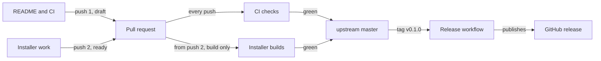

# Pedagogue: CI, installers and the 0.1.0 release

## Where things stand

- Local `master`, `origin/master` and `upstream/master` all sit at `e5cb416`, and the tree is clean.
- `origin` is your private fork `vinniefalco/pedagogue`, and `upstream` is the private `cppalliance/pedagogue`.
- Upstream runs workflows for pull requests from forks right away, and its `master` takes direct pushes. Its one rule has Copilot review a pull request once it leaves draft, and again on each push.
- `CODECOV_TOKEN` is the only Actions secret the repo can read, so this release ships unsigned installers.
- The two pictures sit in the git-ignored `design/scratch/`, and `images/` is an empty folder.
- Paths and commands below are relative to [pedagogue](pedagogue) unless they name another repo.

## Choices I settled

- **The installer crate is a build tool** named `pedagogue-installer`, run as `cargo installer`. It drives Tauri's own bundlers, the way [runvil/crates/build-installer](runvil/crates/build-installer) and [runvil-workshop/crates/build-workshop](runvil-workshop/crates/build-workshop) do (confidence: high - both sibling repos have this shape, and Runvil adds Qt's installer framework only because it ships two components).
- **Formats:** an NSIS setup for Windows, a `.dmg` each for Apple silicon and Intel Macs, and a `.deb` plus an `.AppImage` for Linux x64 (confidence: medium - one real installer per system, with the AppImage for other distributions. An `.rpm` and Linux arm64 are a line each to add).
- **Installers are unsigned**, with an ad hoc signature on macOS, which Tauri's guide sets with the identity `-`. The README and the release notes say which prompt each system shows and how to get past it (confidence: high - Runvil's installers ship the same way today).
- **One version for everything:** the workspace version in `Cargo.toml`, `ui/package.json` and the tag `v0.1.0` (confidence: high - the crates ship as one product).
- **One pull request, two pushes.** It goes from `vinniefalco:master` to `cppalliance:master`, the branch you already work on. The first push holds the README and CI commits, and the installer commits follow in a second push (confidence: high - this is your order of work. GitHub matches a path filter against the whole pull request, so once the installer commits are in, every push builds all four installers, and the CI fixes are cheaper made before that).
- **It opens as a draft** and leaves draft at the second push, so Copilot starts reviewing when the work is complete (confidence: medium - workflows run the same on a draft).
- **Landing it:** once the pull request is green I fast-forward `upstream/master` with a plain push, which GitHub records as a merge of the pull request, and then I tag (confidence: high - history stays linear with the same hashes on both remotes, and it is how you land pull requests in `runvil-harness`).
- **CI scope:** format, clippy, tests on Linux, Windows and macOS, docs, the UI checks, `cargo deny`, `cargo audit` and one gate job. Tests run with plain `cargo test`, the command in `AGENTS.md`, which also runs the doctests (confidence: medium - this is the Rust rulebook's list. Its feature-matrix, MSRV, semver and Miri checks apply to things this workspace keeps fixed: one feature set, a pinned toolchain that is the MSRV, unpublished crates and forbidden `unsafe`).
- **Jobs run only upstream.** Each job skips itself inside a fork, so your fork's Actions minutes stay untouched (confidence: medium - a private fork bills your own account).
- **Badges:** CI, license and platforms. A release-version badge waits until the repo is public, since badge services read public repos only (confidence: high - the other two render for a private repo).
- **The pictures are labeled as design concepts.** They are renders, and the app follows `design/` (confidence: high - a reader should not take them for screenshots).
- **Rulebook departures:** the tool keeps the name you asked for and the house alias `cargo installer`, where the Rust rulebook calls such a crate `xtask`. It shares the workspace version, which names the files it builds. The release is a tag and a workflow, and `cargo-release` joins if the crates ever go to crates.io (confidence: medium - each follows the two sibling repos).

## How the work flows



- Steps 1, 2, 4, 5 and 6 each end with their local checks passing and one commit on `master`. Each message follows `.cursor/rules/commit.mdc` and ends with `Plan: .cursor/plans/pedagogue_ci_and_release_9980d68c.plan.md`.
- Every step uses only what earlier steps delivered. Step 6's workflow takes the command and the file names from step 4 and the changelog entry from step 5.
- Step 4 starts while the first CI round of step 3 runs. If that round fails, the fix comes first: the installer work is set aside with `git stash`, and the fix is checked, committed and pushed on its own.
- Steps 4 to 6 stay local until step 7, so they reach the pull request as one push and one round of workflows.
- The pull request text and my notes are scratch. The final report is output.

## Steps

### 1. readme

- Move `ui7-18-concepts-bottom-quiz-v2.jpg` and `ui7-19-errors-top-progress-v2.jpg` from `design/scratch/` into `images/`, names unchanged.
- In [pedagogue/README.md](pedagogue/README.md): three badge lines above the title, the two pictures and one caption line under the opening paragraph, and `images/` in the Layout list.

```markdown
[](https://github.com/cppalliance/pedagogue/actions/workflows/ci.yml)
[](LICENSE)
[](https://github.com/cppalliance/pedagogue/releases/latest)

# Pedagogue

(the opening paragraph stays as it is)


Concept renders from the design phase. The app follows the reference files in `design/`.
```

- **Check:** `git ls-files images` lists both files, and each `images/` path in the README names one of them.

### 2. ci

- Add `.github/workflows/ci.yml`, patterned on [runvil/.github/workflows/ci.yml](runvil/.github/workflows/ci.yml):
  - Triggers: pushes to `master`, and pull requests.
  - `permissions: contents: read`, and one run per ref with older runs cancelled.
  - Every job has `if: ${{ !github.event.repository.fork }}` and `timeout-minutes: 30`.
  - `env`: `CARGO_INCREMENTAL: 0`, `CARGO_PROFILE_DEV_DEBUG: 0` and `CARGO_TERM_COLOR: always`.
  - Actions: `actions/checkout@v4`, `actions/setup-node@v4` (Node 24, npm cache keyed on `ui/package-lock.json`), and `Swatinem/rust-cache` and `taiki-e/install-action` at the commit SHAs the sibling workflows pin. The toolchain comes from `rust-toolchain.toml`.
- Jobs:
  - `fmt` (`ubuntu-latest`): `cargo fmt --all --check`.
  - `clippy` (`ubuntu-latest`): `cargo clippy --workspace --all-targets --all-features -- -D warnings`.
  - `test` (`ubuntu-22.04`, the release build's image, plus `windows-latest` and `macos-latest`): `cargo test --locked --workspace --all-features --no-run`, then the same without `--no-run`, then a check that the build left the tree clean.
  - `docs` (`ubuntu-latest`): `cargo doc --workspace --no-deps --all-features` with `RUSTDOCFLAGS=-D warnings`.
  - `ui` (`ubuntu-latest`): `npm ci` and `npm run check` in `ui/`.
  - `supply-chain` (`ubuntu-latest`): `cargo deny check` and `cargo audit`.
  - `ci-green`: needs all of the above, runs with `if: ${{ always() && !github.event.repository.fork }}`, and fails when any of them failed or was cancelled. It is the one check to require later.
- `clippy`, `test` and `docs` compile the server, so each first runs `npm ci` in `ui/`. On Linux they also install `libwebkit2gtk-4.1-dev`, `libssl-dev` and `librsvg2-dev`.
- Add `deny.toml`: [runvil-workshop/deny.toml](runvil-workshop/deny.toml) without its Workshop-only parts, which are the `CDLA-Permissive-2.0` and `bzip2-1.0.6` license entries, the `cfg_block` clarify block, the `serde_json` feature ban and the git source list. A dry run with Workshop's file passes on today's lockfile, and so does `cargo audit`.
- Add `cargo deny check` and `cargo audit` to the Checks lists in `AGENTS.md` and `README.md`, and `.github/workflows/` to the README's Layout list.
- **Check:** the four Rust checks, `npm run check`, `cargo deny check` and `cargo audit` all pass here. Both tools are installed on this machine.

### 3. pull-request

- Push `master` to `origin` and open the pull request as a draft:

```text
git push origin master
gh pr create --draft --repo cppalliance/pedagogue --base master --head vinniefalco:master --title "Add CI, installers and the 0.1.0 release"
```

- The body says what the pull request holds now, and that the installer commits follow.
- Watch with `gh pr checks <number> --repo cppalliance/pedagogue --watch`. For each failing job, read its log, fix the cause in a new commit on `master`, push, and watch again.
- **Done when:** `ci-green` is green.

### 4. installer

- **Read first:** [runvil-workshop/crates/build-workshop/src/main/bundle.rs](runvil-workshop/crates/build-workshop/src/main/bundle.rs) for the Tauri command line, and [runvil/crates/build-installer/src/main/installer/collect.rs](runvil/crates/build-installer/src/main/installer/collect.rs) for one definition of the release file names.
- Add `crates/pedagogue-installer`: a library whose one public function is `run`, with a thin `main.rs`, as the desktop crate is. `anyhow` is its one dependency, with `serde_json` and `tempfile` for tests. It joins `default-members`, since it builds with Rust alone.
- Add the alias `installer = "run -p pedagogue-installer --"` to `.cargo/config.toml`.
- Pin the Tauri CLI as an exact dev dependency with `npm install --save-dev --save-exact @tauri-apps/cli@2.12.2` in `ui/`. It is the version Workshop runs against the same Tauri crates.
- What `cargo installer [--target <triple>]` does, in order:
  1. Reads the target from the flag, or from the `host:` line of `cargo -vV`.
  2. Refuses a target outside the four below before anything is built.
  3. Checks that `ui/node_modules/@tauri-apps/cli/tauri.js` exists, and names the fix (`npm ci` in `ui/`) when it is missing.
  4. Clears its output folder and Tauri's bundle folders for the formats it is about to build, so each holds one build's files.
  5. Runs, from `crates/pedagogue-desktop`: `node <tauri.js> build --ci --target <triple> --bundles <formats>`, with the output passed straight through.
  6. Finds the one file with each format's extension at the top level of `<target dir>/<triple>/release/bundle/<format>/`, copies it into `<target dir>/installer/<triple>/` under its release name, and prints the paths. The target folder is `CARGO_TARGET_DIR` when set, else `target/`.
- Targets, formats and release names, with the version taken from the workspace:
  - `x86_64-pc-windows-msvc`: `nsis`, `Pedagogue_0.1.0_x64-setup.exe`
  - `aarch64-apple-darwin`: `dmg`, `Pedagogue_0.1.0_aarch64.dmg`
  - `x86_64-apple-darwin`: `dmg`, `Pedagogue_0.1.0_x64.dmg`
  - `x86_64-unknown-linux-gnu`: `deb,appimage`, `Pedagogue_0.1.0_amd64.deb` and `Pedagogue_0.1.0_amd64.AppImage`
- Modules: `args.rs` (hand-written parser and usage text), `platform.rs` (the list above), `tauri.rs` (the command line), `collect.rs` (find and copy), `run.rs` (the steps and the exit code). Child processes start through a closure, so unit tests record each command and write the files a real build would. Ctrl-C reaches the Tauri CLI through the console, so the crate handles signals with the default behavior.
- Add four keys to the `bundle` object of [pedagogue/crates/pedagogue-desktop/tauri.conf.json](pedagogue/crates/pedagogue-desktop/tauri.conf.json), beside `active` and `icon`:

```json
"category": "Education",
"shortDescription": "A living textbook with a tutor beside the page",
"windows": { "webviewInstallMode": { "type": "embedBootstrapper", "silent": true } },
"macOS": { "signingIdentity": "-" }
```

- **Tests:** the parser, the target list with a refused target, the exact Tauri command for each system, the collector over a temp folder (one file found and copied, a missing file, two candidates), the missing CLI message, and a check that `productName` in `tauri.conf.json` equals the crate's product name. `tests/it/main.rs` runs the real binary for `--help`, an unknown flag and an unsupported target.
- Docs: the code map in `ARCHITECTURE.md`, the README's Layout list, and a README section "Build an installer" that names what the command needs (`npm ci` in `ui/`, and on Linux the packages CI installs).
- **Check:** the Rust and UI checks pass, and `cargo installer` on this machine writes the Windows setup into `target/installer/x86_64-pc-windows-msvc/`. The NSIS tools it needs are already in this machine's Tauri cache. I build the setup here and leave installing to the CI runners.

### 5. version

- `Cargo.toml`: workspace `version = "0.1.0"`, the four internal entries in `[workspace.dependencies]`, and `repository = "https://github.com/cppalliance/pedagogue"`, which each crate inherits with `repository.workspace = true`. One `cargo check --workspace` brings `Cargo.lock` along.
- `ui/`: `npm version 0.1.0 --no-git-tag-version`. A new test, `ui/test/version.mjs`, requires the UI version to equal the workspace version.
- Add `CHANGELOG.md` in the rulebook's format: `## [0.1.0] - <release date>`, one sentence that the installers are unsigned with a pointer to the README, and an Added list (the page commands, the quizzes, the chat, the desktop app, the sample lessons and the installers).
- README: an Install section with the release page, the file for each system, and how to open an unsigned installer:
  - Windows: "Windows protected your PC", then More info, then Run anyway.
  - macOS: the first launch is blocked, then System Settings, Privacy and Security, Open Anyway.
  - Linux: `sudo apt install ./Pedagogue_0.1.0_amd64.deb` on Debian or Ubuntu 22.04 and newer, or make the AppImage executable and run it.
- **Check:** every local check passes again, and `cargo installer` now names its file `Pedagogue_0.1.0_x64-setup.exe`.

### 6. release-workflow

- Add `.github/workflows/release.yml`, patterned on [runvil/.github/workflows/installers.yml](runvil/.github/workflows/installers.yml), with `contents: read` at the top and the same fork guard on every job as in CI.
- Triggers:
  - A tag that matches `v[0-9]+.[0-9]+.[0-9]+`: release.
  - `workflow_dispatch`: build everything and keep the files as artifacts.
  - `pull_request`, build only, with these `paths`: `.github/workflows/release.yml`, `crates/pedagogue-installer/**`, `crates/pedagogue-desktop/tauri.conf.json`, `crates/pedagogue-desktop/icons/**`, `.cargo/config.toml`, `Cargo.toml`, `Cargo.lock`, `rust-toolchain.toml`, `ui/package.json`, `ui/package-lock.json` and `CHANGELOG.md`.
- Jobs:
  - `prepare` (`ubuntu-latest`): reads the version from `Cargo.toml` and requires a tag to equal `v<version>`. On every run it cuts the `## [<version>]` section out of `CHANGELOG.md` into `notes.md`, fails when that section is missing, and uploads the notes.
  - `build`, one per target, with a 60 minute limit: Windows on `windows-latest`, both Mac targets on `macos-latest`, Linux on `ubuntu-22.04` to keep the glibc floor low. Steps: Node 24 and `npm ci`, `rustup target add <triple>`, the cargo cache, then `cargo installer --target <triple>`, the installer check, a clean-tree check, and an upload of `target/installer/<triple>/*` kept for 7 days. The Linux build first installs the three packages CI uses plus `patchelf` and `xdg-utils`, and sets `APPIMAGE_EXTRACT_AND_RUN=1`.
  - `assemble` (`ubuntu-latest`), on every run: gathers the five installers and the notes into one folder, writes `SHA256SUMS` for the installers, lists the folder and uploads it. A pull request then proves everything up to the last step.
  - `publish`, on a tag only, with `contents: write`: downloads the assembled folder and publishes it.
- The installer check in `build`:
  - Windows: a silent install with `/S`, then `%LOCALAPPDATA%\Pedagogue\pedagogue.exe` exists.
  - macOS: mount the `.dmg` read-only, `Pedagogue.app/Contents/MacOS/pedagogue` exists with the target's architecture (`lipo -archs`), and `codesign --verify --deep --strict` passes.
  - Linux: the `.deb` installs with `apt-get install` inside a clean `ubuntu:22.04` container and puts `pedagogue` on the PATH, and the AppImage unpacks with `--appimage-extract` to a tree that holds an executable `pedagogue`.

```yaml
- uses: softprops/action-gh-release@3bb12739c298aeb8a4eeaf626c5b8d85266b0e65 # v2
  with:
    tag_name: ${{ github.ref_name }}
    name: Pedagogue ${{ github.ref_name }}
    body_path: dist/notes.md
    make_latest: true
    files: |
      dist/Pedagogue_*
      dist/SHA256SUMS
```

- Docs: a README section "Release it" (bump the version, add the changelog entry, land it, push the tag), the same rule in `AGENTS.md`, and the two workflows in `ARCHITECTURE.md`.
- **Check:** every local check still passes. The workflow's first run is step 7.

### 7. installer-builds

- Push `master` to `origin`, mark the pull request ready with `gh pr ready`, and update its body to cover the installer work.
- Both workflows now run on each push. Watch them and fix as in step 3.
- Read Copilot's review when it arrives, and fix what is a real problem.
- **Done when:** `ci-green`, the four `build` jobs and `assemble` are green on the same commit.

### 8. release

- Land the pull request and tag the landed commit:

```text
git push upstream master
git tag -a v0.1.0 -m "Pedagogue 0.1.0"
git push upstream v0.1.0
```

- If `upstream/master` has moved by then, the plain push is refused. I then merge the pull request on GitHub with a merge commit, fast-forward `master` and `origin` to it, and tag that commit.
- Watch the Release run, then confirm with `gh release view v0.1.0 --repo cppalliance/pedagogue` that the release is published with six files: the five installers and `SHA256SUMS`. Download the Windows setup and `SHA256SUMS`, and match the hash.
- Push the tag to `origin` too, so the fork matches. The fork guard keeps that push idle there.
- Final report, as output and in chat: links to the pull request, the CI run and the release, what each installer was checked for, every fix made in steps 3 and 7, and what stays open.

## Risks and the stop rule

- These tests and the Tauri build have run only on Windows so far. Workshop builds the same Tauri versions on the same runner images today, so the toolchain is proven, and the open part is this repo's own code on Linux and macOS.
- `cargo deny` and `cargo audit` pass on today's lockfile. A new advisory can fail them on any day, as `url` 2.5.8 did in `runvil-harness` this morning. The fix is a version bump, or a reviewed entry in `deny.toml` with its reason.
- Workshop builds its Mac bundle as a plain `.app`, so Tauri's `.dmg` step is new to this house. If it proves flaky on the runner, the crate builds the `.app` and calls `hdiutil create` itself, as `build-installer` does.
- `publish` runs for the first time on the tag. `assemble` covers everything before its one step.
- Cost at list price, from the org's billing rates and Workshop's job times: a CI round is about 1 dollar, a round with the four installer builds about 2 to 3 dollars, and a clean pass through the whole plan about 6 dollars. macOS minutes are most of it, at ten times the Linux rate.
- Workshop's Windows CI job takes about 13 minutes, so the Windows and macOS test jobs here will sit a little over the rulebook's ten minute goal. The Linux jobs take 1 to 6 minutes there.
- **Stop rule:** when the same check fails twice for the same cause, I stop and bring you the options. I also stop if the release run needs a code fix after the tag is pushed, since the choice is then between moving the tag and releasing 0.1.1.

## Left for later plans

- Code signing and notarization, once certificates exist: Apple Developer ID with notarization, and Authenticode for Windows.
- Auto-update through Tauri's updater.
- Linux arm64 and an `.rpm`.
- A startup error dialog for the installed app. A release build on Windows runs without a console, so a startup error such as an unreadable script path ends the app silently. The default launch plays the built-in lesson on a port the system picks, and both are reliable (confidence: medium on waiting - the fix needs the dialog plugin and a reshaped startup, which is its own piece of work).
- The Nu HTML checker as a CI job (confidence: medium on waiting - its first run happens on a CI runner and may ask for design-file changes that deserve their own review).
- `CONTRIBUTING.md` and git hooks, which wait for the first outside contributor.
