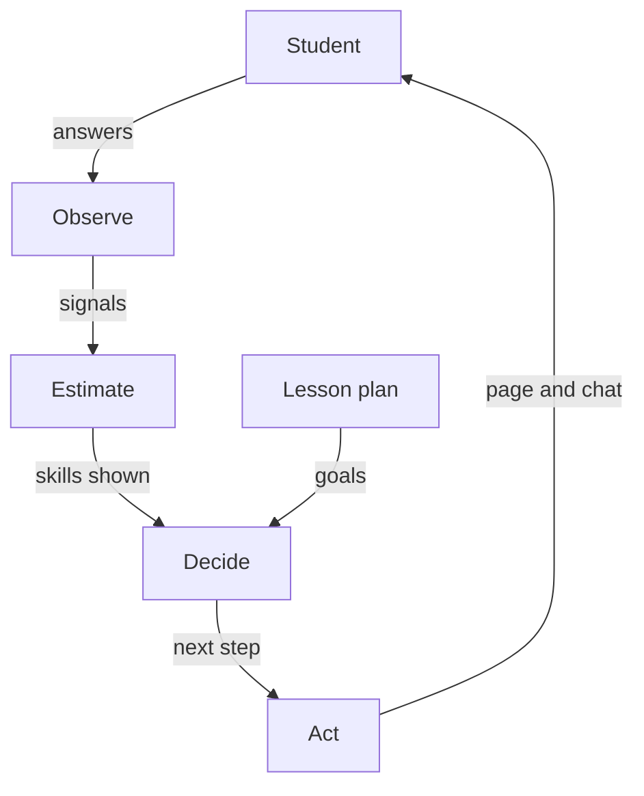

# Pedagogue Vision Document

## Deliverable

One markdown document, "Pedagogue Vision: Adaptive Learning in a Living Textbook", about 3,000 to 3,500 words. Adaptive learning is the subject. The document opens as a short pitch, sets out how the tutor measures progress and chooses the next step, and ends with a research agenda built for literature research. About two thirds of the words go to sections 4 to 7 and section 11.

- The report is written straight to `pedagogue/vision.md`, at the root of the Pedagogue repository beside [pedagogue/README.md](pedagogue/README.md) and [pedagogue/ARCHITECTURE.md](pedagogue/ARCHITECTURE.md). That is your instruction, and the path is free today.
- It stays uncommitted on `master` until you have reviewed it. (confidence: medium - the summary is yours to approve, and the full text should get the same look before it enters history)
- **The CI and release plan is at work in the same repository.** Its first step has `README.md` and two pictures in `images/` staged right now. This plan adds untracked files only and leaves the index alone, so that plan's commits stay exactly as it staged them.

## Executive summary - draft 2, yours to edit

The Pedagogue is an adaptive learning program. It teaches one student at a time, measures what that student understands as the lesson goes, and picks each next step from that measurement. In Benjamin Bloom's 1984 studies, the average student tutored one-on-one scored above 98 percent of a conventional class. Our aim is that result for every learner.

The student sees a living textbook: a page on one side and a tutor on the other. The tutor writes the page as the lesson unfolds: explanations, diagrams, worked examples and quizzes. Every answer, every retry and every question in the chat tells the tutor where the student stands.

Then it adapts. A student who answers well moves quickly past what they already know. A student who gets stuck gets a smaller step, a second explanation from a new angle, a return to the idea underneath, and fresh research from the web when the lesson plan runs thin. Moving on takes a demonstrated skill, so a lucky guess earns a second question. The tutor remembers each student and picks up where they stopped.

Two things decide whether this works: how we measure a student's progress, and what we do when a student is stuck or far ahead. Our prototype already follows published findings on mastery learning, scaffolding and practice testing. This document sets out the adaptive loop as it stands and the questions we are taking to the research literature. The goal is a product where every technique traces to a study, and to a result we can measure ourselves.

Runvil, our open-source prompt engine, makes that practical. The teaching rules run as code, the model does the explaining and the judging, and every session leaves a complete record. That record is our laboratory: it shows which techniques work, and for which students.

The lessons come from lesson plans built out of knowledge we capture by interviewing experts. Capture is the first half of our pipeline. This document is about the second half, the teaching.

Three pieces exist today: a tutor prompt that teaches through mastery-gated milestones, a desktop app with the complete textbook and chat interface, and Runvil, which already runs prompts like these. Next we connect the app to a live model, settle the shape of the lesson plan, and begin the research this document lays out.

## The idea in one picture

## Design positions the document will take

- **Two questions organize the document: how we measure progress, and what we do next.** (confidence: high - your words)
- **Every adaptive rule is written as a hypothesis with its source.** Sections 4 to 7 list each rule the prototype follows today, the study it cites, and what is still to confirm. (confidence: high - that form lets a research run confirm, adjust or replace one rule at a time)
- **The student model scores skills, never the person** (safety). It holds what this student has shown for each skill in the lesson, and it stays with the student. (confidence: medium - a per-skill record is what the pacing decisions need)
- **The mastery rules run as Lua.** The prototype in [tools-public/prototypes/tutor/tutor.md](tools-public/prototypes/tutor/tutor.md) asks the model to keep the counters, such as `run >= 2` and backing up after two failures. On Runvil the Lua holds the gate, and the model explains, judges free-text answers and picks examples. (confidence: high - this split is Runvil's stated purpose)
- **The page is both the tool set and the measuring instrument.** The 21 page commands in [pedagogue/crates/pedagogue-session/src/lesson/command.rs](pedagogue/crates/pedagogue-session/src/lesson/command.rs) reach the model as tools, and every student action returns as an event with its attempt number. (confidence: high - the app was built to this shape)
- **The run record is the laboratory.** Each session's events and decisions are recorded, so we can study which moves helped. (confidence: medium - Runvil records every run today, and tools for studying the record are still to be built)
- **One tutor prompt, with the lesson plan as data.** The lesson plan's shape is open, and the document states what adaptivity needs from it. (confidence: high - this is what you described)
- **Web research: curated sources first, live search when the plan runs thin.** A reader step treats every fetched page as data. (confidence: medium - the prototype allows vetted URLs only, and you asked for wider reach)
- **Tutor identity.** The prototype tutors speak as real named teachers, for example Jim Blandy (safety). The document states the "trusted confidant, never a clone" rule in its own words: the tutor teaches an expert's material in that expert's manner and speaks as a tutor. (confidence: medium - it is the rule you already set for the autobiographical product)

## Outline

1. **Executive summary** - as settled above.
2. **Adaptive learning in one page** - Bloom's challenge, the loop in the picture above (observe, estimate, decide, act), and the two questions.
3. **What the student sees** - the living textbook as the place where teaching and measuring happen together: page elements, the four color families, the five quiz kinds, the chat. The pop quiz picture sits here, the progress picture in section 4 and the tailored note picture in section 5.
4. **Measuring progress** - the signals the app captures today (picks, attempt numbers, free-text answers, chat messages, Continue presses), the state the prototype keeps (current milestone, mastered list, in-a-row counter, misconception flags), and the mastery test for each of the three modes. One example it raises: the app lets a student retry a multiple-choice quiz until right, so a right answer on a third try says less than one on a first try.
5. **When the student is stuck** - how the prototype detects it (two failures in a row, a partial answer, a quiz missed twice) and the moves it makes: the help ladder, a second explanation from a new angle, backing up to the idea underneath, a partial worked step, drilling down to sources and the web.
6. **When the student is ahead** - the fast path: testing out, compressing, skipping, harder transfer tasks. This is the thinnest part of the prototype, and the document says so.
7. **Rules that keep the measurement honest** - the answer stays hidden until the check is passed, a right answer after a hint earns a fresh question, the second question, holding a correct position under pushback, naming the move in place of praise.
8. **How it works on Runvil** - what is code and what is model, the Pedagogue as a Host, and the run record. Figure 2 shows lesson plan, tutor prompt, Gateway, session and textbook UI.
9. **What adaptivity asks of the lesson plan** - prerequisites, key concepts, more than one explanation, paired check items, misconceptions, sources. One paragraph of background, paraphrased from the knowledge vision: knowledge leaves when people leave, structured interviews capture it (SAGE, the Mentographist), extraction turns transcripts into principles and stories, and those become lesson plans.
10. **Where we are today and what comes next** - built: the tutor prompt and its eight generated tutors, the desktop app (21 page commands, quiz rules and answer key in Rust, 196 Rust tests and 72 UI tests, scripted lessons). Next: live inference, the lesson plan, saved progress, the student model, speech, a tablet target.
11. **Research agenda** - the foundation for the literature work. Every entry has the same four parts: the question, what the prototype does today, leads to start from, and what a useful answer gives us (a technique to build and a way to measure it). Each question is a standalone topic that [tools-public/planning/research.md](tools-public/planning/research.md) can take as is.

## Research agenda entries

- **Measuring progress**
  - Student models: how adaptive systems estimate what a student knows, and the smallest model that works from a few answers per skill.
  - Mastery criteria: how many right answers, in what form, count as mastery, and what too much and too little practice cost.
  - Scoring retries: what an answer on a second or third attempt tells us.
  - Judging open answers: how reliably a model marks short answers, essays and explanations, and how to check its marking.
  - Signals beyond right and wrong: response time, hint use, the student's own questions, confidence.
  - Retention and transfer: whether the learning lasts and applies to new cases, through delayed tests, spaced review and transfer tasks.
- **When the student is stuck**
  - Telling productive struggle from spinning in place.
  - Help: hints, scaffolding and fading, worked examples, and when to tell versus when to hold back.
  - Remediation: backing up to prerequisites, a second explanation, feedback aimed at a misconception.
  - Feedback: which kinds and what timing help learning.
- **When the student is ahead**
  - Acceleration: pretests, testing out, and how help that suits a novice slows an expert.
  - Difficulty and sequence: the success rate to aim for, and how to choose and order the next item.
- **Evidence that it works**
  - Tutoring effects: Bloom's result, the studies of tutoring systems that followed, and the first studies of model tutors.
  - Model behavior as a tutor: answer leaks, yielding to pushback, and the rubrics for judging a tutor.
  - Deployed adaptive systems: the techniques they use and the results they publish.
  - Our own evidence: study designs that work with a small group, with the Runvil class as the first case.
- **Around the loop**
  - Motivation: what keeps an adult learner coming back.
  - Trustworthy web research during a lesson.

## Small points I settled

- **Background stays short.** Succession, tacit knowledge and SAGE get one paragraph in section 9, paraphrased, and the report stands on its own. (confidence: high - your instruction)
- **Leads come in two tiers.** The first is the 20 citations already in the tutor prototype. The second is leads I add from memory, such as knowledge tracing, the studies that followed Bloom, and work on worked examples and spaced practice, each marked as a lead for the research runs to confirm. (confidence: medium - named leads make the research runs sharper)
- **One web pass checks citations only.** A subagent confirms that each named paper exists with the right authors and year. The findings themselves come from your research runs. (confidence: medium - a wrong citation in a foundation document would mislead the work built on it)
- **The Bloom line stays, attributed to Bloom.** Later studies report smaller effects, and the research agenda takes that up. (confidence: medium - it is the strongest hook, and its size is debated)
- **Market size and marketplace mechanics stay outside this report.** The competitor question becomes "what deployed adaptive systems do and what they publish". (confidence: medium - it keeps this document on adaptive learning)
- **The document says "we"** and leaves the company name to you. (confidence: medium - the written knowledge vision does the same)
- **"Pedagogue" names the product, "tutor" names the model that teaches.** (confidence: medium - it keeps the two apart for the reader)
- **Three pictures, one new file.** The report reuses the two pictures the CI and release plan put in `pedagogue/images/`, and adds one. (confidence: medium - the README and the report then share one set, and each picture shows one part of the loop)
  - `ui7-18-concepts-bottom-quiz-v2.jpg`, already in `images/`: a pop quiz, with the tutor confirming the answer. It shows measuring.
  - `ui7-19-errors-top-progress-v2.jpg`, already in `images/`: the progress box and the tutor naming what unlocks the next chapter. It shows the mastery gate.
  - `ui7-20-errors-bottom-essay-v2.jpg`, one of the two you attached: the "Tailored for you" note, a short essay and the tutor guiding the student. It shows adapting, and it is the foot of the same page as the progress picture. It moves from `design/scratch/` to `images/` with its name unchanged, the way the other two did.
  - `ui7-01-straw-poll-top-quiz.jpg`, the other one you attached, stays in scratch. It shows a quiz, which the first picture covers.
- **Captions say "Design concept"**, as the README's captions do. The pictures are renders, and the app follows `design/`.
- **The report links to nothing in the classroom repository.** The knowledge vision is paraphrased, per your instruction. The same goes for the class transcripts and the student outputs: the report uses what they say in its own words. (confidence: medium - you named the one file, and the same reasoning covers the rest of that repository)
- **Links the report keeps:** files inside the Pedagogue repository by relative path, the SAGE paper and the tutor prototype by their GitHub addresses, and the cited studies. (confidence: medium - the tutor prototype is where each adaptive rule and its citation come from)
- **One README line changes, in the same commit as the report.** The Layout entry for `images/` says "the two concept renders at the top of this file", and it gets reworded to cover the third picture and to point at `vision.md`. That edit waits until the CI and release plan has committed its README change.
- **The date line is dropped.** The report follows the other documents at the repository root, which end with their last section.

## Steps

1. **Settle the executive summary.** You edit draft 2 above in this plan file, and I revise until you say it is right. Everything after this step reads from the settled text.
2. **Move `ui7-20-errors-bottom-essay-v2.jpg`** from `pedagogue/design/scratch/` to `pedagogue/images/`, and leave it untracked.
3. **Write `pedagogue/vision.md` in five chunks:** sections 1 to 3, sections 4 and 5, sections 6 to 8, sections 9 and 10, section 11.
4. **Check it, three passes in parallel.** A style pass covers dashes, mermaid label length, the wording rules and links. A fact pass has a subagent compare every number, quote and rule against the workspace sources. A citation pass has a subagent confirm each named paper on the web.
5. **Hand it to you for review.** The commit waits for your word. `master` is the head of the release pull request, so a commit pushed while that pull request is open becomes part of it. You choose then whether the report rides in that pull request or waits until it lands.
