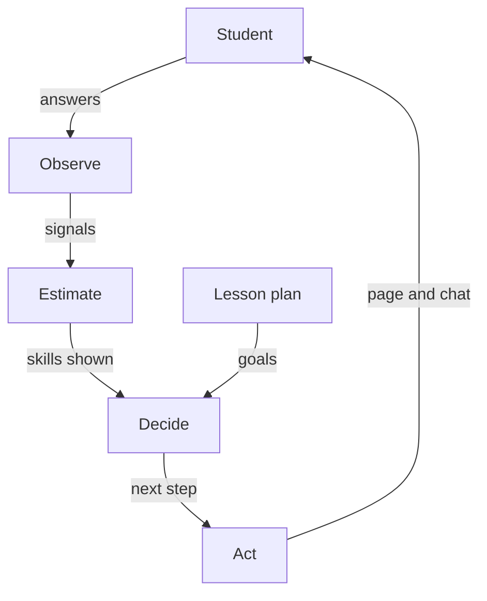
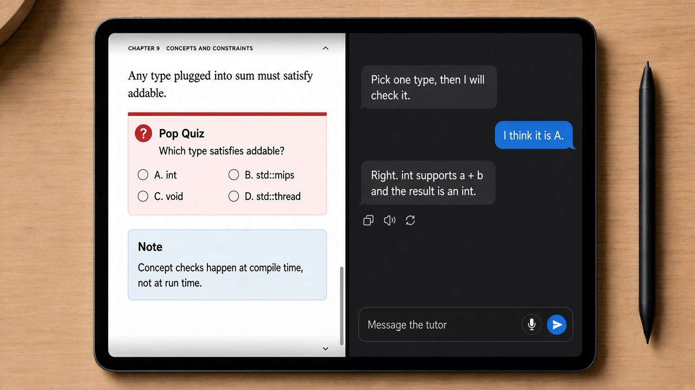
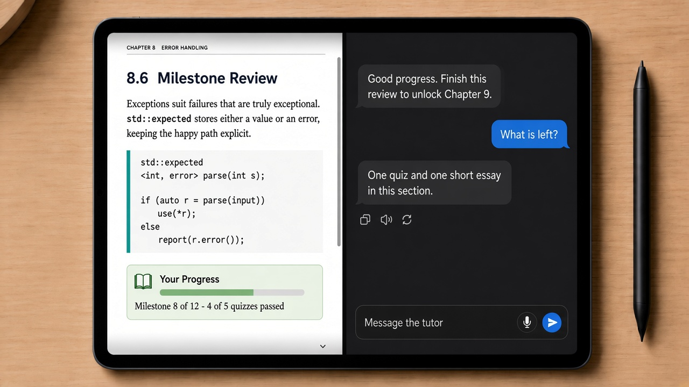
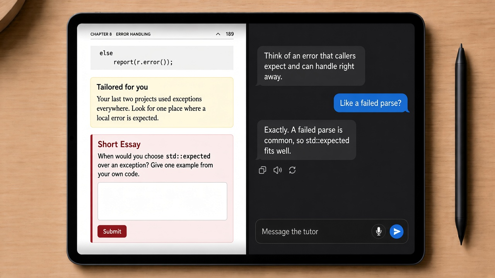
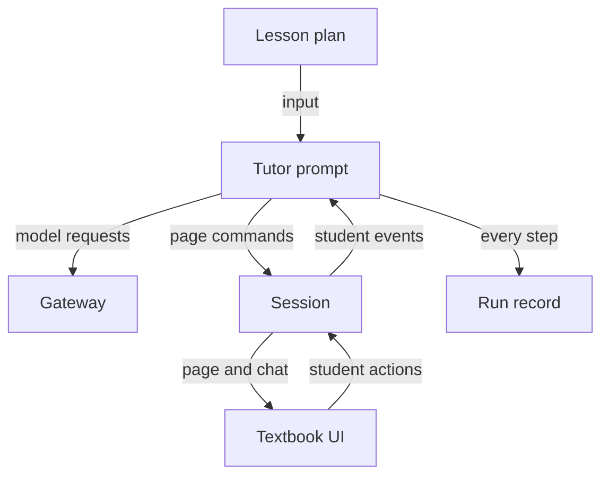

# Pedagogue Vision: Adaptive Learning in a Living Textbook

## Executive summary

The Pedagogue is an adaptive learning program. It teaches one student at a time, measures what that student understands as the lesson goes, and picks each next step from that measurement. In studies Benjamin Bloom reported in 1984, the average tutored student scored above 98 percent of a conventional class. Our aim is that result for every learner.

The student sees a living textbook: a page on one side and a tutor on the other. The tutor writes the page as the lesson unfolds: explanations, diagrams, worked examples and quizzes. Every answer, every retry and every question in the chat tells the tutor where the student stands.

Then it adapts. A student who answers well moves quickly past what they already know. A student who gets stuck gets a smaller step, a second explanation from a new angle, a return to the idea underneath, and fresh research from the web when the lesson plan runs thin. Moving on takes a demonstrated skill, so a lucky guess earns a second question. The tutor remembers each student and picks up where they stopped.

Two things decide whether this works: how we measure a student's progress, and what we do when a student is stuck or far ahead. Our prototype already follows published findings on mastery learning, scaffolding and practice testing. This document sets out the adaptive loop as it stands and the questions we are taking to the research literature. The goal is a product where every technique traces to a study, and to a result we can measure ourselves.

Runvil, our open-source prompt engine, makes that practical. The teaching rules run as code, the model does the explaining and the judging, and every session leaves a complete record. That record is our laboratory: it shows which techniques work, and for which students.

The lessons come from lesson plans built out of knowledge we capture by interviewing experts. Capture is the first half of our pipeline. This document is about the second half, the teaching.

Three pieces exist today: a tutor prompt that teaches through mastery-gated milestones, a desktop app with the complete textbook and chat interface, and Runvil, which already runs prompts like these. Next we connect the app to a live model, settle the shape of the lesson plan, and begin the research this document lays out.

## Adaptive learning in one page

In 1984 Benjamin Bloom reported what two of his doctoral students had found. Learners taught by a tutor, alone or in groups of two or three, with a check and a correction after each unit, finished about two standard deviations above a conventional class. A tutor for every student costs more than most schools and employers can pay. So Bloom asked for teaching methods that reach the same result at scale, and he called that search [the 2 sigma problem][bloom]. Later reviews of tutoring and of tutoring systems report smaller effects, and question Q13 below takes up how large an effect to expect.

A good tutor works in a loop, and so does the Pedagogue.

*Figure 1. The adaptive loop.*

- **Observe.** Quiz picks, written answers, retries and questions.
- **Estimate.** Which skills the student has shown so far.
- **Decide.** The next step, set against the goals in the lesson plan: move on, practice again, explain another way, or go back.
- **Act.** The next part of the page, and a reply in the chat.

The whole design comes down to two questions. How do we measure a student's progress? And what do we do next, both when the student is stuck and when the student is far ahead? The sections below give our current answer as numbered rules, H1 to H18. Each rule is a hypothesis. It names the source it rests on, or says the source is still to find, and it says what the research has to confirm.

## What the student sees

The student works in one window with two panes. The left pane is a textbook page that the tutor writes as the lesson goes. The right pane is a chat with the tutor.

*Design concept. The page asks, the student answers, and the tutor responds.*

The tutor builds the page from 21 page commands: running text, footnotes, bar charts, tree diagrams, timelines, boxes and quizzes. Color tells the student what each box is for.

- **Blue** is information: a tip, a key idea, a fact to remember.
- **Yellow** is personal: a note tailored to this student, a hint, the next milestone.
- **Green** is progress. It is rare, so it means something.
- **Red** is a quiz.

There are five kinds of quiz: multiple choice, select all that apply, a short answer, a short essay, and a one-line code exercise. The page marks the first two at once. The tutor reads and marks the other three.

Teaching and measuring happen in the same place. Every quiz on the page is also a reading of what the student knows, and every yellow box is the tutor acting on that reading.

## Measuring progress

*Design concept. Progress is counted in milestones, and the next chapter opens when the review is passed.*

**What the tutor can see.** The app reports every student action to the tutor as one line of text:

- each quiz attempt, with the options picked, whether the pick was right, and the attempt number
- each written answer, with its attempt number
- each chat message
- each press of Continue
- each request for the tutor's last reply again

**What the tutor remembers.** The tutor prototype keeps a small record for each lesson: the current milestone, the list of milestones mastered, a count of right answers in a row, and short notes on the misconceptions it has heard. It saves the record after every change, so a lesson resumes where it stopped. A record that follows each student across lessons is part of the student model ahead.

**What counts as mastery.** A lesson is a chain of milestones, and each milestone has one of three gates.

| Gate | Used for | The student moves on when |
| --- | --- | --- |
| Practice | a skill the student has to perform | the check is right on the first try with no hint, and a second, parallel task is right too |
| Quiz | knowledge that benefits from a check | one comprehension question is answered right, or the student chooses to move on after two misses |
| Read | material to take in at the student's own pace | the student says so, after an optional self-check |

The rules behind this, as hypotheses:

| Rule | What we do today | Rests on | Still to confirm |
| --- | --- | --- | --- |
| H1 | One skill per milestone, sized to 5 to 15 minutes of work | [Knewton][knewton], which suggests about 10 minutes of teaching per learning objective | The right grain for adults, and for judgment as well as procedure |
| H2 | Each milestone gets the gate that fits how its subject is usually taught, and the student can override the choice | Source to find | Which gate suits which knowledge, and who should choose it |
| H3 | Mastery at a practice gate is two right answers in a row, the second on a fresh task | [Bloom 1984][bloom]; [ASSISTments][assistments], three right in a row | The count, and whether a probability beats a counter |
| H4 | The student record is small: position, mastered list, streak and misconception notes | [Bayesian Knowledge Tracing][bkt] | What an estimate for each skill adds, and what it costs |
| H5 | Every attempt is counted. A wrong pick closes, and the student picks again from what remains | Our first guess, to be tuned in trials | What a right answer on a second or third attempt is worth |

H5 shows why this needs research. The app lets a student retry a multiple-choice quiz until the right option is found. A right answer on the third try says less than one on the first. The app passes the attempt number to the tutor, and the rule for scoring it is still to write.

The student model scores skills, never the person. It records what this student has shown for each skill in the lesson, and it stays with the student.

## When the student is stuck

*Design concept. The yellow box ties the lesson to this student's own projects, and the tutor leads the student to find the example.*

The tutor prototype reads three signs that a student is stuck: a partly right answer, a missed quiz question, and two failures in a row at a practice gate. Each sign has its own response.

| Rule | What we do today | Rests on | Still to confirm |
| --- | --- | --- | --- |
| H6 | Help rises with each failure | [Wood, Bruner and Ross 1976][wbr] | How to fade help as the student improves, which the rules leave open today |
| H7 | At a practice gate, a partly right answer starts a help ladder: name what is right, narrow the question, ask one question that locates the gap, show part of a worked step, then pose the original task again | Our own design. [Jung 2024][ascd] writes on keeping struggle productive, and [Renkl and Atkinson 2003][renkl] on worked steps that fade | The order of the rungs, and when struggle stops paying |
| H8 | A missed quiz question gets a second explanation from a new angle, then one more try. After a second miss the student chooses: mark it and move on, or stay and dig deeper | [Rosenshine 2012][rosenshine], on reteaching when a check fails. The new angle is our own choice | Whether a new angle beats a repeat, and how to pick the angle |
| H9 | Two failures in a row at a practice gate send the lesson back to the milestone before it, which is taught again | [Bloom 1984][bloom]; [Wood, Bruner and Ross 1976][wbr] | The threshold, and whether to go back one step or to the true prerequisite |
| H10 | Each milestone lists two or three common misconceptions. The tutor listens for them and notes the ones it hears | Source to find. [Maurya et al. 2024][mrbench] score a tutor on finding the student's mistake | How to find the misconception behind a wrong answer, and which feedback fixes it |
| H11 | When the student asks for more, the lesson material runs short, or a fact is in doubt, the tutor reads a vetted source and brings back short notes | [Khan Academy][khan], whose tutor checks its math with a separate math agent | How to keep outside material accurate and at the student's level |

On the page, the same ideas show up as boxes. A wrong quiz option closes and shows feedback that explains the mistake and keeps the right answer back. A hint box builds on what the student already knows. A "Tailored for you" box connects the lesson to the student's own work.

The prototype reads from sources that were vetted when the lesson was built. The product goes one step further: vetted sources first, then a live web search when those run thin. A separate reader step treats every fetched page as data and never as instructions.

## When the student is ahead

This is the thinnest part of the prototype, and the place where the literature has the most to give us. Today the fast path is set before the lesson starts, and inside a lesson every student walks every milestone in order.

| Rule | What we do today | Rests on | Still to confirm |
| --- | --- | --- | --- |
| H12 | Knowledge the student states up front shortens the chain of prerequisite topics | Source to find | How to measure prior knowledge with a pretest or a first hard question, in place of asking |
| H13 | A right answer moves the student on at once: one question at a quiz gate, two tasks at a practice gate, and at will at a read gate | [Bloom 1984][bloom], where mastery sets the pace | How much practice a strong student can skip before retention suffers |
| H14 | Some milestones ask for transfer: the skill applied to a new case | [Brunmair and Richter 2019][brunmair], on interleaving similar material | Whether harder transfer tasks are the right next step for a student who is ahead |

The product needs a set of moves to match the ones for a stuck student: testing out of a milestone, a compressed explanation, skipping ahead, and harder tasks. Question Q11 takes up a reported effect that makes this more than a convenience: help that suits a beginner can slow an expert down.

## Rules that keep the measurement honest

A measurement is as good as the conditions it was taken under. These rules protect those conditions.

| Rule | What we do today | Rests on | Still to confirm |
| --- | --- | --- | --- |
| H15 | The answer stays hidden until the student earns it. The tutor holds it back, and the app keeps the answer key out of the page until the student finds the answer | [Maurya et al. 2024][mrbench], whose rubric scores a tutor on revealing the answer | How often a model tutor leaks the answer, and how to test for it |
| H16 | A right answer straight after a hint stays out of the mastery count, and the streak returns to zero | [Rivers 2021][rivers], on how learners misjudge what they know from practice tests; [ASSISTments Skill Builders][skillbuilders], where a hint resets the streak | Whether a re-test after a delay measures better than one in the same sitting |
| H17 | The tutor holds a correct position when the student pushes back, and yields to new evidence alone | [Sharma et al. 2023][sharma] | How well the hold survives a long lesson |
| H18 | The prototype tutor names the specific move the student made, in place of praise. The app's green success strip does praise, so the two are still to reconcile | Source to find | Whether praise helps or hurts an adult learner |

## How it works on Runvil

Runvil is our open-source prompting language. A prompt is one Markdown file with prose and Lua code side by side. The prose is for the model, and the Lua is the logic. That split suits an adaptive tutor, and it shapes the next step: the app becomes a Runvil Host, a program that runs prompts through Runvil.

- **Code holds the rules.** Counting right answers, opening and closing gates, and deciding when to back up become Lua. In the prototype the model keeps these counts itself. In Lua the count is exact and the gate holds every time.
- **The model does what takes judgment.** It explains, picks examples, marks written answers, and hears the misconception behind a wrong answer.
- **The page is the model's tool set.** The 21 page commands reach the model as tools, and each student action comes back as a line of text.
- **Every run is recorded.** Runvil records each step of a run, so every session will leave a full account of what the student did and what the tutor decided. The tools for studying those records are ours to build.

*Figure 2. The Pedagogue as a Runvil Host, the design for the next step.*

One tutor prompt serves every lesson, and the lesson plan is its input. The Gateway is the one process that holds the model vendors' keys, so they stay out of the app and the page.

One more change from the prototype. Its tutors take the name and voice of a famous teacher in each field. In the product the tutor may teach in an expert's manner and from that expert's material, and it always speaks as a tutor. It is a trusted guide to what the expert knows, never a copy of the person.

## What adaptivity asks of the lesson plan

A lesson plan is the tutor's input. Its format is still open: it may be a folder of Markdown files, or JSON. What it has to hold is clearer, because each adaptive move needs something to work with.

| The tutor wants to | So the lesson plan holds |
| --- | --- |
| know what to teach next, and where to back up to | milestones in order, each with one goal and its prerequisites |
| explain, and explain again another way | key concepts, and more than one way in: an example, a story, a contrast |
| check a skill twice | paired check tasks of equal difficulty |
| hear what went wrong | the common misconceptions for each milestone |
| go deeper | sources vetted in advance |
| pick the right gate | a gate for each milestone, and the kind of knowledge it builds |

Where do lesson plans come from? Most of what makes people good at their work was never written down, and it leaves when they leave. Structured interviews draw it out. The [SAGE paper](https://github.com/cppalliance/wg21-sage/blob/master/wg21-sage.md) describes the method, and our interviewer prototype, the Mentographist, conducts the interviews. Extraction prompts turn the transcripts into principles and the experiences behind them, and a lesson plan is built from those. An expert's stories are the second and third explanations a stuck student needs. The tutor prototype builds its lessons from web research today, and the first lesson plan built from captured knowledge is among the next steps.

## Where we are today and what comes next

**Built today**

- **The tutor prompt.** [The prototype](https://github.com/cppalliance/tools-public/blob/master/prototypes/tutor/tutor.md) builds one tutor for each topic in a chain of prerequisites. It has produced eight tutors so far, three on Rust and five on Python, one of them in Arabic. Each one teaches through mastery-gated milestones.
- **The app.** A desktop app with the complete textbook page and chat: 21 page commands, five kinds of quiz, and the quiz rules and the answer key held in Rust. 234 Rust tests and 77 UI tests pass. Today it plays scripted lessons with a stand-in tutor. [ARCHITECTURE.md](ARCHITECTURE.md) explains how the parts fit together.
- **Runvil.** It runs prompts end to end today, with Lua, model calls, tool loops, web search and a record of every run.

**Next**

1. Connect the app to a live model through Runvil, with the mastery rules in Lua.
2. Settle the shape of the lesson plan, and build the first one from captured knowledge.
3. Save each student's progress between sessions.
4. Build the student model that the research points to.
5. Add speech for the microphone and read-aloud buttons, and a tablet version.

Our first students are our own team. They are learning Runvil from its designer, and what works for them becomes our first case study.

## Research agenda

This agenda is the foundation for the literature work. Each question stands alone, so a research run can take it as written. Every entry has four parts: the question, what we do today, leads to start from, and what a useful answer gives us, which is a technique to build and a way to measure it.

The leads are starting points. Some are sources the tutor prototype already cites, and the rest are papers we know by name. Each named paper has been checked to exist, with the authors and year given here. What each one found is for the research to establish.

### Measuring progress

**Q1. Student models**

- **Question:** How do adaptive systems estimate what a student knows, and what is the smallest model that works from a few answers per skill?
- **Today:** A position, a mastered list and a streak counter (H3, H4).
- **Leads:** [Corbett and Anderson 1995][corbett], knowledge tracing; [Pavlik, Cen and Koedinger 2009][pfa], performance factors analysis; [Piech et al. 2015][dkt], deep knowledge tracing; [Pelánek 2017][pelanek], an overview of learner models.
- **A useful answer gives us:** An estimate for each skill that code can update after every answer, and a test of how well it predicts the student's next answer.

**Q2. Mastery criteria**

- **Question:** How many right answers, in what form, count as mastery, and what do too much and too little practice cost?
- **Today:** Two right answers in a row at a practice gate, the second on a parallel task, and one right answer at a quiz gate (H2, H3).
- **Leads:** [Bloom 1984][bloom]; [Kelly et al. 2015][kelly], knowledge tracing against a run of right answers; [Cen, Koedinger and Junker 2007][cen], over-practice; [Rohrer and Taylor 2006][rohrer], overlearning.
- **A useful answer gives us:** A mastery rule for each gate, with the retention we expect from it.

**Q3. Scoring retries**

- **Question:** What does a right answer on a second or third attempt tell us about what the student knows?
- **Today:** Every attempt reaches the tutor with its number. The rule for scoring it is still to write (H5).
- **Leads:** [Attali 2015][attali], multiple-try feedback; [Epstein et al. 2002][epstein], answer until correct; [Wang and Heffernan 2013][wang], partial credit in knowledge tracing.
- **A useful answer gives us:** A score for each attempt number that feeds the student model.

**Q4. Judging open answers**

- **Question:** How reliably does a model mark short answers, essays and explanations, and how do we check its marking?
- **Today:** In the prototype the model judges each answer in the chat. The app takes a verdict of right or wrong with a line of feedback, and a stand-in supplies it until the live model is connected. The help ladder also needs a verdict of partly right (H7).
- **Leads:** [Burrows, Gurevych and Stein 2015][burrows], automatic short answer grading; [Chi et al. 1994][chi], self-explanation.
- **A useful answer gives us:** A marking guide for each question type, and an agreement rate against human markers.

**Q5. Signals beyond right and wrong**

- **Question:** What do response time, hint use, the student's own questions and stated confidence add to the picture?
- **Today:** Picks, written answers, attempt numbers and chat messages reach the tutor.
- **Leads:** [Butterfield and Metcalfe 2001][butterfield], errors made with high confidence; [Baker et al. 2004][baker], gaming the system; [Aleven et al. 2003][aleven], help seeking.
- **A useful answer gives us:** A short list of extra signals worth capturing, each with the decision it changes.

**Q6. Retention and transfer**

- **Question:** Does the learning last, and does it apply to new cases?
- **Today:** Every check happens inside the lesson, minutes after the teaching (H3, H14).
- **Leads:** [Roediger and Karpicke 2006][roediger], test-enhanced learning; [Cepeda et al. 2006][cepeda], spaced practice; [Rivers 2021][rivers]; [Barnett and Ceci 2002][barnett], far transfer; [Settles and Meeder 2016][settles], a spaced repetition model.
- **A useful answer gives us:** A review schedule with delayed tests, and a format for transfer tasks.

### When the student is stuck

**Q7. Productive struggle or spinning in place**

- **Question:** How do we tell a student who is working toward an answer from one who is going nowhere?
- **Today:** Two failures in a row trigger a step back (H9).
- **Leads:** [Beck and Gong 2013][beck], wheel-spinning; [Kapur 2008][kapur], productive failure; [D'Mello and Graesser 2012][dmello], confusion and frustration; [Jung 2024][ascd].
- **A useful answer gives us:** A detector with a threshold, and the share of stuck students it catches before they quit.

**Q8. Help**

- **Question:** Which help works best: hints, scaffolding that fades, or worked examples? And when should the tutor tell, and when hold back?
- **Today:** The help ladder, and a hint that resets the streak (H6, H7, H16).
- **Leads:** [Wood, Bruner and Ross 1976][wbr]; [Wood, Wood and Middleton 1978][wwm], contingent help; [Koedinger and Aleven 2007][koedinger], the assistance dilemma; [Sweller and Cooper 1985][sweller], worked examples; [Renkl and Atkinson 2003][renkl].
- **A useful answer gives us:** A help policy by student level, and a measure of learning gained per unit of help.

**Q9. Remediation**

- **Question:** After a failure, what fixes it: a step back to a prerequisite, a second explanation, or feedback aimed at the misconception?
- **Today:** A step back and a second explanation each have a trigger. Misconceptions are listed and noted (H8, H9, H10).
- **Leads:** [Bloom 1984][bloom], correctives; [Brown and Burton 1978][brown], diagnosing procedural bugs; [Posner et al. 1982][posner], conceptual change.
- **A useful answer gives us:** A rule for choosing among the three, and the pass rate on the next attempt.

**Q10. Feedback**

- **Question:** Which kinds of feedback help learning, and at what timing?
- **Today:** Wrong options explain the mistake and keep the answer back, and the prototype tutor names the move in place of praise (H15, H18).
- **Leads:** [Hattie and Timperley 2007][hattie]; [Shute 2008][shute]; [Kluger and DeNisi 1996][kluger]; [Mueller and Dweck 1998][mueller], praise.
- **A useful answer gives us:** Feedback patterns for each question type, and their effect on the next attempt.

### When the student is ahead

**Q11. Acceleration**

- **Question:** How do pretests and testing out work, and how does help that suits a novice slow an expert?
- **Today:** Prior knowledge is stated up front, and a right answer moves the student on at once (H12, H13).
- **Leads:** [Kalyuga et al. 2003][kalyuga], the expertise reversal effect; [Richland, Kornell and Kao 2009][richland], the pretesting effect; [Weiss and Kingsbury 1984][weiss], adaptive testing.
- **A useful answer gives us:** A test-out rule and a compressed path, measured as time saved at equal retention.

**Q12. Difficulty and sequence**

- **Question:** What success rate should we aim for, and how do we choose and order the next task?
- **Today:** Milestones of 5 to 15 minutes run in the lesson plan's order for every student (H1).
- **Leads:** [Rosenshine 2012][rosenshine], about 80 percent success; [Wilson et al. 2019][wilson], the 85 percent rule; [Ericsson 2008][ericsson], deliberate practice; [Bjork 1994][bjork], desirable difficulties; [Brunmair and Richter 2019][brunmair], interleaving.
- **A useful answer gives us:** A target success band and a rule for picking the next task, measured as the band each student actually gets.

### Evidence that it works

**Q13. Tutoring effects**

- **Question:** How large an effect should we expect, given Bloom's result, the studies of tutoring systems that followed, and the first studies of model tutors?
- **Today:** We quote Bloom's figure as the aim.
- **Leads:** [Bloom 1984][bloom]; [VanLehn 2011][vanlehn]; [Ma et al. 2014][ma]; [Kulik and Fletcher 2016][kulik]; [Nickow, Oreopoulos and Quan 2024][nickow]; [Kestin et al. 2025][kestin]; [Bastani et al. 2025][bastani].
- **A useful answer gives us:** An honest target effect size, and the comparison group to measure against.

**Q14. Model behavior as a tutor**

- **Question:** Where do model tutors fail, such as leaking answers and yielding to pushback, and which rubrics judge a tutor?
- **Today:** Prompt rules (H15, H17).
- **Leads:** [Sharma et al. 2023][sharma]; [Maurya et al. 2024][mrbench], the MRBench rubric; [LearnLM][learnlm]; [Khan Academy][khan].
- **A useful answer gives us:** A test suite for the tutor prompt, run on every change.

**Q15. Deployed adaptive systems**

- **Question:** Which techniques do deployed systems use, and what results do they publish?
- **Today:** Our prior art is the source list in the tutor prototype.
- **Leads:** [Pane et al. 2014][pane], Cognitive Tutor Algebra at scale; [Roschelle et al. 2016][roschelle], ASSISTments; [Settles and Meeder 2016][settles], Duolingo; [Doignon and Falmagne 1985][doignon], the knowledge spaces behind ALEKS; [Knewton][knewton].
- **A useful answer gives us:** A table of technique by system by published result, and the gaps we can fill.

**Q16. Our own evidence**

- **Question:** Which study designs give sound results with a small group of students?
- **Today:** Runvil records every run, and the app joins it in the next step. Our team is the first group.
- **Leads:** [Hake 1998][hake], gains from tests before and after; [Kratochwill et al. 2010][kratochwill], single-case designs.
- **A useful answer gives us:** A study plan for our first students, and the measures to record from day one.

### Around the loop

**Q17. Motivation**

- **Question:** What keeps an adult learner coming back?
- **Today:** Progress boxes, milestones and plain feedback (H18).
- **Leads:** [Ryan and Deci 2000][ryan], self-determination theory; [Keller 1987][keller], the ARCS model.
- **A useful answer gives us:** A small set of motivation moves, measured by how many students finish.

**Q18. Trustworthy web research during a lesson**

- **Question:** How does a tutor bring in outside material that is accurate, at the student's level, and safe from hostile pages?
- **Today:** Vetted sources, read by a separate step that returns short notes (H11).
- **Leads:** [Greshake et al. 2023][greshake], indirect prompt injection; [Willison 2023][willison], the dual LLM pattern; [Khan Academy][khan].
- **A useful answer gives us:** A source policy and a reader design, with an error rate from spot checks.

[bloom]: https://web.mit.edu/5.95/readings/bloom-two-sigma.pdf
[knewton]: https://dev.knewton.com/content/best-practices-adaptive-content/
[rosenshine]: https://www.aft.org/sites/default/files/Rosenshine.pdf
[wbr]: https://doi.org/10.1111/j.1469-7610.1976.tb00381.x
[wwm]: https://doi.org/10.1177/016502547800100203
[rivers]: https://doi.org/10.1007/s10648-020-09578-2
[ericsson]: https://doi.org/10.1111/j.1553-2712.2008.00227.x
[renkl]: https://doi.org/10.1207/S15326985EP3801_3
[brunmair]: https://doi.org/10.1037/bul0000209
[sharma]: https://arxiv.org/abs/2310.13548
[mrbench]: https://arxiv.org/abs/2412.09416
[khan]: https://blog.khanacademy.org/how-khan-academy-is-building-a-better-ai-tutor-our-most-recent-learnings/
[bkt]: https://en.wikipedia.org/wiki/Bayesian_Knowledge_Tracing
[assistments]: https://sites.google.com/site/assistmentsdata/home/2009-2010-assistment-data
[skillbuilders]: https://www.assistments.org/individual-resource/skillbuilders
[learnlm]: https://arxiv.org/abs/2412.16429
[ascd]: https://www.ascd.org/el/articles/thriving-in-the-zone-of-productive-struggle
[corbett]: https://doi.org/10.1007/bf01099821
[pfa]: https://doi.org/10.3233/978-1-60750-028-5-531
[dkt]: https://arxiv.org/abs/1506.05908
[pelanek]: https://doi.org/10.1007/s11257-017-9193-2
[kelly]: https://educationaldatamining.org/EDM2015/proceedings/poster630-631.pdf
[cen]: https://ebooks.iospress.nl/volumearticle/3568
[rohrer]: https://doi.org/10.1002/acp.1266
[attali]: https://doi.org/10.1016/j.compedu.2015.08.011
[epstein]: https://doi.org/10.1007/bf03395423
[wang]: https://doi.org/10.1007/978-3-642-39112-5_19
[burrows]: https://doi.org/10.1007/s40593-014-0026-8
[chi]: https://doi.org/10.1207/s15516709cog1803_3
[butterfield]: https://doi.org/10.1037/0278-7393.27.6.1491
[baker]: https://doi.org/10.1145/985692.985741
[aleven]: https://doi.org/10.3102/00346543073003277
[roediger]: https://doi.org/10.1111/j.1467-9280.2006.01693.x
[cepeda]: https://doi.org/10.1037/0033-2909.132.3.354
[barnett]: https://doi.org/10.1037/0033-2909.128.4.612
[settles]: https://doi.org/10.18653/v1/P16-1174
[beck]: https://doi.org/10.1007/978-3-642-39112-5_44
[kapur]: https://doi.org/10.1080/07370000802212669
[dmello]: https://doi.org/10.1016/j.learninstruc.2011.10.001
[koedinger]: https://doi.org/10.1007/s10648-007-9049-0
[sweller]: https://doi.org/10.1207/s1532690xci0201_3
[brown]: https://doi.org/10.1207/s15516709cog0202_4
[posner]: https://doi.org/10.1002/sce.3730660207
[hattie]: https://doi.org/10.3102/003465430298487
[shute]: https://doi.org/10.3102/0034654307313795
[kluger]: https://doi.org/10.1037/0033-2909.119.2.254
[mueller]: https://doi.org/10.1037/0022-3514.75.1.33
[kalyuga]: https://doi.org/10.1207/S15326985EP3801_4
[richland]: https://doi.org/10.1037/a0016496
[weiss]: https://doi.org/10.1111/j.1745-3984.1984.tb01040.x
[wilson]: https://doi.org/10.1038/s41467-019-12552-4
[bjork]: https://doi.org/10.7551/mitpress/4561.003.0011
[vanlehn]: https://doi.org/10.1080/00461520.2011.611369
[ma]: https://doi.org/10.1037/a0037123
[kulik]: https://doi.org/10.3102/0034654315581420
[nickow]: https://doi.org/10.3102/00028312231208687
[kestin]: https://doi.org/10.1038/s41598-025-97652-6
[bastani]: https://doi.org/10.1073/pnas.2422633122
[pane]: https://doi.org/10.3102/0162373713507480
[roschelle]: https://doi.org/10.1177/2332858416673968
[doignon]: https://doi.org/10.1016/S0020-7373(85)80031-6
[hake]: https://doi.org/10.1119/1.18809
[kratochwill]: https://files.eric.ed.gov/fulltext/ED510743.pdf
[ryan]: https://doi.org/10.1037/0003-066X.55.1.68
[keller]: https://doi.org/10.1007/BF02905780
[greshake]: https://arxiv.org/abs/2302.12173
[willison]: https://simonwillison.net/2023/Apr/25/dual-llm-pattern/
